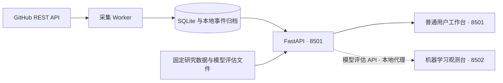

# RepoVantage

<div align="center">
  <strong>面向开源项目的活动分析与维护洞察工作台</strong>
  <br />
  <sub>从 GitHub 事件采集，到仓库分析、横向比较与离线模型评估。</sub>
  <br /><br />
  <code>Vue 3</code>&nbsp; · &nbsp;<code>FastAPI</code>&nbsp; · &nbsp;<code>SQLite</code>&nbsp; · &nbsp;<code>Python 3.12</code>
</div>

<br />

RepoVantage 将仓库数据采集、活动指标、项目比较和机器学习研究放在同一个本地工作台。页面以实际观测数据为依据；样本不足、部分覆盖和数据缺失会明确标注，不把未知状态当作零。

## 产品工作区

| 工作区 | 能做什么 |
| --- | --- |
| **总览** | 查看仓库活动、近期维护信号和任务进度。 |
| **仓库与分析** | 管理仓库；分析 Commit、Issue、PR、Release 的活动与处理耗时。 |
| **项目比较** | 比较 2–5 个仓库，查看共同时间窗、指标差异和加权排名。 |
| **研究** | 查看固定研究样本及其分组统计；研究样本不会混入普通仓库列表。 |
| **任务与设置** | 管理采集任务、分页预算和可选的 GitHub Token。 |
| **机器学习观测台** | 查看 M1 维护模式聚类、M2 活动趋势分类的训练/验证/留出结果与运行诊断。 |

## 系统结构

普通用户工作台与机器学习观测台分别运行在 **8501** 和 **8502**。8501 提供 FastAPI 与普通用户页面；8502 是独立前端，通过本地代理读取 8501 的模型评估接口，内部密钥由服务端保管，不进入前端构建产物。采集 Worker 负责与 GitHub 通信并保存观测记录。



### 两套前端

| 地址 | 面向用途 | 内容 |
| --- | --- | --- |
| [`127.0.0.1:8501`](http://127.0.0.1:8501) | 普通用户 | 仓库管理、仓库分析、比较、研究和任务。 |
| [`127.0.0.1:8502`](http://127.0.0.1:8502) | 模型观测 | 离线模型评估、固定数据切分与当前进程诊断。 |
| [`127.0.0.1:8501/docs`](http://127.0.0.1:8501/docs) | 本地开发 | FastAPI 接口文档。 |
| [`127.0.0.1:8501/healthz`](http://127.0.0.1:8501/healthz) | 本地诊断 | API 健康检查。 |

## 快速启动

需要 **Python 3.12、Node.js/npm 和 [uv](https://docs.astral.sh/uv/)**。在仓库根目录执行：

```bash
uv run --locked --all-extras python -m scripts.start
```

启动器会准备 Python 依赖；首次运行时安装前端依赖；构建两套前端；创建本机 `.env` 和随机 `INTERNAL_API_KEY`；升级数据库；然后启动 FastAPI、Worker、8501 用户页面和 8502 机器学习观测台。按 `Ctrl+C` 可统一停止所有服务。

GitHub Token 可选。未配置时使用 GitHub 匿名请求额度；需要更高额度时，可在设置页配置个人 Token。详细环境变量、数据导入与 API 说明见[后端文档](README_backend.md)。

## 机器学习评估边界

观测台展示的是**固定历史样本上的研究评估**，不是对 GitHub 全体仓库的随机抽样，也不代表生产模型已经获准上线。

- **M1 · 维护模式聚类**：K-Means；训练集与独立留出集各 150 个仓库。展示簇分布、轮廓系数和留出仓库的模型分配。
- **M2 · 活动趋势分类**：逻辑回归；在训练组内滚动验证，并使用独立的 150 个留出仓库评估未来四周活动类别。
- 聚类描述活动形态，趋势分类评估历史切分上的预测表现；两者都不构成仓库质量评分或推荐结论。

样本版本、来源指纹、覆盖情况和限制见[数据资产清单](reports/数据资产清单.md)及[模型实验说明](ML_实验结果与选型解释.md)。

## 数据与本机状态

仓库包含可复现研究所需的固定数据包、模型文件和评估结果；运行产生的本机数据库与密钥不随普通 Git 提交上传。

| 数据 | 用途 | Git 状态 |
| --- | --- | --- |
| `data/datasets/course-research-300-v1/` | 固定 300 仓库研究样本与 150/150 分组。 | 随项目提供 |
| `data/datasets/course-research-events-300-v1/` | 研究详情使用的历史事件快照。 | 随项目提供 |
| `ml/course/experiments/course-150-150-v1/` | M1/M2 模型产物、训练输入和评估结果。 | 随项目提供 |
| `data/app.db`、`data/collected/`、`.env` | 本机数据库、动态采集归档和本机密钥。 | Git 忽略 |

固定数据均有来源和时间范围；它们是历史快照，不会在启动时重新抓取。页面展示的研究结论应结合各自的数据覆盖和评估限制阅读。

## 开发入口

### 普通用户前端

```bash
cd frontend
npm ci
VITE_DATA_MODE=mock npm run dev
```

若要联调真实 API，先按快速启动命令启动后端，再运行 `VITE_DATA_MODE=http npm run dev`。

### 机器学习控制台

完整项目启动时会一并启动 8502。若 API 已用其他方式运行，也可以单独启动控制台：

```bash
uv run --locked --all-extras python -m scripts.start_ml_console
```

前端开发说明见 [`frontend/README.md`](frontend/README.md)。指标定义、采集合同、覆盖规则和图表说明见 [`docs/insights/`](docs/insights/)。

---

项目仓库：[MauriceLiang/RepoVantage](https://github.com/MauriceLiang/RepoVantage) · [后端与 API](README_backend.md) · [数据资产清单](reports/数据资产清单.md)
