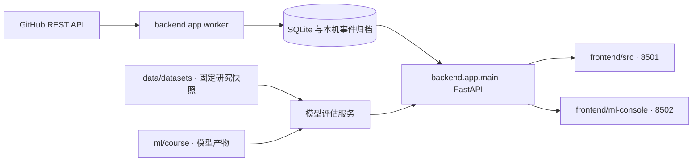

# 项目结构与模块边界

RepoVantage 按运行职责拆分为后端、普通用户前端、机器学习观测台、固定研究资产和模型生命周期资料。两套前端共享后端 API，但独立构建与运行。

## 运行结构



8501 提供普通用户工作台和 FastAPI；8502 是独立的机器学习观测前端，通过本机代理访问模型评估接口。Worker 负责 GitHub 采集和后台任务，数据库迁移由 Alembic 管理。

## 根目录

```text
.
├── backend/                  # FastAPI、业务服务、GitHub 接入、Worker
├── frontend/                 # Vue 普通用户前端与独立 ML 控制台
├── migrations/               # Alembic 数据库迁移
├── data/datasets/            # 经审查、随仓库发布的固定样本快照
├── ml/course/                # 课程研究模型、特征与评估产物
├── ml-production/            # 模型注册、准入证据与运行配置
├── scripts/                  # 仓库级 Python 命令与数据/模型工作流
├── tests/                    # 后端测试、契约测试与 fixtures
├── docs/                     # 架构、开发指南和指标约定
├── reports/                  # 研究结果、数据清单与历史归档
├── pyproject.toml            # Python 包与工具配置
├── uv.lock                   # 锁定的 Python 依赖
└── README.md                 # 项目入口、快速启动与能力概览
```

## 目录职责

| 目录 | 放置内容 | 边界约定 |
| --- | --- | --- |
| `backend/app/api/` | HTTP 路由、请求校验、浏览器 API | 适配 HTTP；业务流程交由 `services/`。 |
| `backend/app/services/` | 仓库、分析、数据集和模型评估用例 | 组合领域逻辑；不在路由里实现采集或评分算法。 |
| `backend/app/analytics/` | 指标、特征和图表序列计算 | 保持计算可复用，不依赖 Vue 组件。 |
| `backend/app/integrations/` | GitHub REST API 客户端 | 外部 API 访问集中在集成层。 |
| `backend/app/persistence/` | SQLAlchemy 数据库连接和实体 | Schema 变更通过根目录 `migrations/` 管理。 |
| `backend/app/pipeline/`、`worker/` | 事件清洗、归档回放、后台任务执行 | 长任务由 Worker 执行，HTTP 请求只负责提交和查询。 |
| `frontend/src/` | 8501 普通用户页面 | 只通过后端 API 获取业务数据。 |
| `frontend/ml-console/` | 8502 模型评估与运行观测界面 | 独立构建，通过后端 API 读取评估数据；不直接加载数据库。 |
| `data/datasets/` | 固定研究样本和历史事件包 | 仅纳入经过审核、可追溯版本化的数据包。 |
| `data/` 根目录运行文件 | SQLite、动态采集归档、本机状态 | 默认由 `.gitignore` 排除，不随代码提交。 |
| `ml/course/` | 离线研究特征、模型产物、固定评估结果 | 说明研究实验；不代表生产模型准入。 |
| `ml-production/` | 模型注册、外部验证、准入与调度材料 | 与课程研究产物分开维护，记录模型生命周期状态。 |
| `scripts/` | 仓库根目录执行的维护、数据和研究命令 | 已发布的 `python -m scripts.<命令>` 路径视为 CLI 接口；调整时同步更新调用方和文档。 |
| `tests/` | `backend/` 行为、API 契约、测试数据 | fixtures 与被测模块分开放置，避免混入运行数据目录。 |
| `docs/` | 架构、安装运维和指标口径 | 面向使用与维护者的约定文档；临时设计稿和本地资料包不纳入发布。 |
| `reports/` | 数据资产、模型实验和历史验收材料 | 研究结论与实现文档分开，历史材料显式标注归档状态。 |

## 依赖与数据约定

1. Web 前端不连接 SQLite，也不持有 GitHub Token 或 `INTERNAL_API_KEY`；外部凭据只由后端进程读取。
2. Git 管理代码、迁移、锁文件、明确选定的固定研究数据和评估产物；运行数据库与动态缓存留在本机。
3. `data/datasets/` 是可追溯研究快照；`data/app.db`、`data/collected/`、`.env` 是运行状态，二者不能混为一个“数据目录”。
4. `ml/course/` 与 `ml-production/` 表达不同生命周期：离线课程评估不会自动成为生产准入。
5. 根目录 `README.md` 是唯一项目首页；启动、后端、结构和模型研究说明分别放在对应文档位置。

## 文件与文件夹逐项说明

以下索引覆盖本清单整理时 Git 跟踪的全部 501 个文件。目录说明给出模块边界；表格逐文件说明其职责。压缩数据文件按数据类型解释，不展开重复的仓库记录。忽略规则之外的本机文件不属于 GitHub 克隆得到的项目内容，见本页末尾的“本机生成内容”。

### 根目录与 CI

| 路径 | 职责 |
| --- | --- |
| **README.md** | 产品说明、快速启动、双前端端口、机器学习评估边界和数据资产摘要。 |
| **.env.example** | 环境变量模板；只列配置项，不存放真实密钥。 |
| **.gitignore** | 排除本机密钥、虚拟环境、动态数据库、采集缓存、前端依赖和构建产物；明确允许提交经过审核的固定数据与文档。 |
| **alembic.ini** | Alembic 数据库迁移工具配置与迁移脚本位置。 |
| **pyproject.toml** | Python 版本、后端依赖、可选开发依赖、包构建和 pytest 配置。 |
| **uv.lock** | 锁定 Python 依赖解析结果，保证安装版本可复现。 |
| **.github/workflows/analysis-window.yml** | CI 工作流；针对分析窗口相关改动执行自动化校验。 |

### backend/：API、业务用例和采集 Worker

| 路径 | 职责 |
| --- | --- |
| **backend/__init__.py** | 后端 Python 包入口。 |
| **backend/app/__init__.py** | 应用包入口。 |
| **backend/app/main.py** | FastAPI 应用装配、生命周期、错误处理、中间件、路由注册和健康检查。 |
| **backend/app/core/__init__.py** | 核心配置包入口。 |
| **backend/app/core/clock.py** | UTC 时间生成、序列化与 GitHub 时间解析，统一时间边界。 |
| **backend/app/core/config.py** | 环境配置读取、数据库 URL 解析和 Settings 实例。 |
| **backend/app/core/exceptions.py** | 业务异常类型，供服务层和 API 统一映射错误响应。 |
| **backend/app/api/__init__.py** | API 适配层包入口。 |
| **backend/app/api/browser.py** | 本地浏览器安全网关；为两个前端代理 API 请求并保护内部密钥。 |
| **backend/app/api/dependencies.py** | 路由依赖，例如内部 API Key 校验和 GitHub 客户端创建。 |
| **backend/app/api/helpers.py** | API 通用响应封装和分页辅助函数。 |
| **backend/app/api/v1/__init__.py** | v1 路由包入口。 |
| **backend/app/api/v1/analytics.py** | 总览、统计、数据质量、比较和模型评估/运行状态接口。 |
| **backend/app/api/v1/datasets.py** | 精选数据集状态、导入导出、覆盖率与仓库目录接口。 |
| **backend/app/api/v1/exports.py** | CSV 导出路由，包括研究洞察和项目比较。 |
| **backend/app/api/v1/github.py** | GitHub 仓库搜索和仓库输入解析接口。 |
| **backend/app/api/v1/insights.py** | 维护分析、Issue/PR/Commit/Release 洞察、详情和相关图表接口。 |
| **backend/app/api/v1/library.py** | 个人仓库库、分组成员、分组锁定和仓库增删接口。 |
| **backend/app/api/v1/repositories.py** | 仓库详情、刷新、分析、时间序列和数据清理接口。 |
| **backend/app/api/v1/settings.py** | GitHub Token 配置状态、保存和移除接口；不向浏览器返回 Token。 |
| **backend/app/api/v1/system.py** | 系统和服务状态接口。 |
| **backend/app/api/v1/tasks.py** | 采集任务查询、取消/删除、重试和完成任务清理接口。 |
| **backend/app/integrations/__init__.py** | 外部系统集成包入口。 |
| **backend/app/integrations/github/__init__.py** | GitHub 集成包入口。 |
| **backend/app/integrations/github/client.py** | GitHub REST API 客户端：搜索、分页、重试、限流和输入校验。 |
| **backend/app/persistence/__init__.py** | 持久化包入口。 |
| **backend/app/persistence/db.py** | SQLAlchemy 引擎、会话、事务和 SQLite 写锁辅助。 |
| **backend/app/persistence/models.py** | 仓库、数据集、分组、导入任务、快照及相关 SQLAlchemy 实体。 |
| **backend/app/pipeline/__init__.py** | 数据处理管道包入口。 |
| **backend/app/pipeline/archive_replay.py** | 从本地归档预览或重放分析，不访问 GitHub。 |
| **backend/app/pipeline/cleaner.py** | 清洗仓库元数据和基础资料。 |
| **backend/app/pipeline/collection_archive.py** | 分页原始活动归档的写入、读取、校验和修剪。 |
| **backend/app/pipeline/event_normalizer.py** | 校验并规范化外部事件，移除不需要的个人载荷。 |
| **backend/app/pipeline/feature_builder.py** | 从仓库资料和已采集信息生成基础分析指标。 |
| **backend/app/pipeline/quality.py** | 汇总数据覆盖和整体质量状态。 |
| **backend/app/pipeline/raw_archive.py** | 归档和读取原始 JSON 响应。 |
| **backend/app/schemas/__init__.py** | API schema 包入口。 |
| **backend/app/schemas/analytics.py** | 总览、统计、数据集列表和系统分析响应结构。 |
| **backend/app/schemas/common.py** | 分页、统一成功/错误响应、来源元数据和 DTO 基类。 |
| **backend/app/schemas/insights.py** | 维护洞察、指标质量、活动点、耗时分布和 Release 数据结构。 |
| **backend/app/schemas/ml_evaluation.py** | M1/M2 评估、仓库结果、模型决策与比较权重请求结构。 |
| **backend/app/schemas/repositories.py** | 仓库搜索、摘要、详情、添加和分组请求/响应结构。 |
| **backend/app/schemas/settings.py** | GitHub Token 设置的请求和脱敏状态结构。 |
| **backend/app/schemas/tasks.py** | 后台任务、模块进度、重试和删除响应结构。 |
| **backend/app/analytics/__init__.py** | 指标与特征计算包入口。 |
| **backend/app/analytics/chart_data.py** | 把已观测事件归并为总览与仓库图表序列，并处理覆盖边界。 |
| **backend/app/analytics/course_ml_features.py** | M2 课程模型的训练与线上共用特征、趋势标签和数据充分性规则。 |
| **backend/app/analytics/insights.py** | 基于 UTC 观测事件计算维护洞察、耗时分位数和质量状态的纯计算逻辑。 |
| **backend/app/analytics/maintenance_features.py** | M1/M2 共用的 52 周维护行为特征生成与有效性检查。 |
| **backend/app/analytics/maintenance_features_v2.py** | 维护时间序列形态特征候选，降低活动规模对形态判断的影响。 |
| **backend/app/analytics/metrics.py** | 基础仓库指标、数值摘要和 Spearman 相关性统计。 |
| **backend/app/services/__init__.py** | 业务服务包入口。 |
| **backend/app/services/analytics.py** | 总览、统计、覆盖率和数据质量的业务编排。 |
| **backend/app/services/course_ml.py** | 读取固定课程模型文件并执行轻量 M1/M2 推理。 |
| **backend/app/services/course_research_dataset.py** | 固定 300 仓库研究数据包校验及向本机分析数据库的增量导入。 |
| **backend/app/services/course_test_events.py** | 固定历史事件快照验证、导入以及仓库洞察数据来源选择。 |
| **backend/app/services/dataset_bundle.py** | 从本机数据库生成脱敏精选数据集包。 |
| **backend/app/services/dataset_import.py** | 精选数据包校验、状态、版本判定及导入任务排队。 |
| **backend/app/services/github_token_settings.py** | 本机 GitHub Token 文件读写和脱敏配置状态管理。 |
| **backend/app/services/insight_comparison.py** | 研究洞察指标比较和横向比较结果组装。 |
| **backend/app/services/insights.py** | 维护洞察的查询、持久化、窗口选择和来源质量状态。 |
| **backend/app/services/issue_comment_repair.py** | 对 Issue 评论做带检查点的补采，只保存必要事件元数据。 |
| **backend/app/services/maintenance.py** | 维护观测结果持久化、缓存、任务排队和模型输入状态读取。 |
| **backend/app/services/maintenance_collection.py** | 收集 M1/M2 所需的最近完整 UTC 周 Commit 和 PR 证据。 |
| **backend/app/services/ml_evaluation.py** | 组织 M1/M2 固定研究评估结果与单仓库课程模型结果。 |
| **backend/app/services/model_evaluation_dashboard.py** | 为独立机器学习控制台提供只读评估文件与图表数据。 |
| **backend/app/services/model_registry.py** | 受信模型清单、哈希/准入检查、受限数值推理和缓存回退。 |
| **backend/app/services/repositories.py** | 仓库/数据集初始化、任务创建、快照选择和分析状态汇总。 |
| **backend/app/services/repository_data.py** | 清理仓库采集数据并更新相关精选数据导入状态。 |
| **backend/app/services/selection.py** | 同场景候选筛选、显式权重评分和反馈记录；不产生机器学习结论。 |
| **backend/app/services/selection_v44.py** | v4.4 选型工作区的版本化、同场景证据和补充数据状态。 |
| **backend/app/worker/__init__.py** | 后台 Worker 包入口。 |
| **backend/app/worker/collection.py** | GitHub 活动分页采集、覆盖记录和断点续采。 |
| **backend/app/worker/dataset_import.py** | 精选数据包的可恢复后台导入、暂存、发布和失败清理。 |
| **backend/app/worker/executor.py** | 普通仓库任务执行总控，协调基础/深度采集、持久化、限流和计时。 |
| **backend/app/worker/main.py** | 常驻采集 Worker 进程入口与配额暂停状态维护。 |
| **backend/app/worker/maintenance.py** | Worker 中的近期维护数据任务执行和结果更新。 |
| **backend/app/worker/progress.py** | 后台任务及模块进度写入、尝试租约隔离与状态转换。 |
| **backend/app/worker/queue.py** | 从数据库领取仓库采集和数据导入任务、维护租约与阶段状态。 |
| **backend/app/worker/telemetry.py** | 记录采集分页、模块和任务耗时等结构化运行遥测。 |
| **backend/app/ml/maintenance_numeric_worker.py** | 隔离子进程，只对 JSON 数值输入执行固定规模 K-Means 推理。 |

### data/：固定数据包与本机数据落点

Git 跟踪 data/datasets 中经过审查的固定快照，以及 data/manifests 中的校验记录。运行时数据库、动态采集归档和原始数据由 .gitignore 排除。

| 路径 | 职责 |
| --- | --- |
| **data/.gitkeep** | 保留运行数据目录；不含用户数据。 |
| **data/datasets/course-research-300-v1/README.md** | 300 仓库研究快照的来源、结构和使用方式。 |
| **data/datasets/course-research-300-v1/DATA_NOTICE.md** | 研究样本来源、许可与解释限制提示。 |
| **data/datasets/course-research-300-v1/dataset.json** | 研究数据包元信息和版本标识。 |
| **data/datasets/course-research-300-v1/repositories.json.gz** | 压缩仓库级静态元数据和特征快照。 |
| **data/datasets/course-research-300-v1/weekly_features.json.gz** | 压缩 300 个仓库的周级特征数据。 |
| **data/datasets/course-research-300-v1/split_manifest.json** | 训练/留出仓库清单、分组及来源指纹。 |
| **data/datasets/course-research-300-v1/SHA256SUMS** | 固定研究包文件校验和。 |
| **data/datasets/course-research-events-300-v1/README.md** | 300 仓库历史事件快照包说明。 |
| **data/datasets/course-research-events-300-v1/dataset.json** | 历史事件包版本、仓库数和内容来源元信息。 |
| **data/datasets/course-research-events-300-v1/events.sqlite3.gz** | 压缩的只读 SQLite 历史事件快照。 |
| **data/datasets/course-test-events-v1/README.md** | 150 个留出仓库历史事件快照的范围与使用说明。 |
| **data/datasets/course-test-events-v1/dataset.json** | 留出仓库事件包元信息和版本。 |
| **data/datasets/course-test-events-v1/events.sqlite3.gz** | 压缩的 150 仓库历史事件 SQLite 快照。 |
| **data/datasets/featured-v1/README.md** | 应用内精选演示数据包说明。 |
| **data/datasets/featured-v1/DATA_NOTICE.md** | 精选演示数据的来源和适用范围提示。 |
| **data/datasets/featured-v1/dataset.json** | 精选数据包版本、文件清单和生成信息。 |
| **data/datasets/featured-v1/SHA256SUMS** | 精选数据包内容校验和。 |
| **data/datasets/featured-v1.zip** | 与精选数据目录对应的可分发 ZIP 文件。 |
| **data/datasets/featured-v1/repositories.jsonl.gz** | 压缩仓库主记录。 |
| **data/datasets/featured-v1/memberships.jsonl.gz** | 压缩仓库与演示数据集的成员关系。 |
| **data/datasets/featured-v1/snapshots.jsonl.gz** | 压缩仓库指标快照。 |
| **data/datasets/featured-v1/analysis.jsonl.gz** | 压缩仓库分析结果。 |
| **data/datasets/featured-v1/coverage.jsonl.gz** | 每个仓库、模块的采集覆盖与数据质量记录。 |
| **data/datasets/featured-v1/insights.jsonl.gz** | 压缩维护洞察结果。 |
| **data/datasets/featured-v1/events/commits.jsonl.gz** | 压缩 Commit 活动事件。 |
| **data/datasets/featured-v1/events/issues.jsonl.gz** | 压缩 Issue 活动事件。 |
| **data/datasets/featured-v1/events/pulls.jsonl.gz** | 压缩 Pull Request 活动事件。 |
| **data/datasets/featured-v1/events/releases.jsonl.gz** | 压缩 Release 活动事件。 |
| **data/datasets/featured-v1/details/commits.jsonl.gz** | 压缩 Commit 详情记录。 |
| **data/datasets/featured-v1/details/issues.jsonl.gz** | 压缩 Issue 详情记录。 |
| **data/datasets/featured-v1/details/pulls.jsonl.gz** | 压缩 Pull Request 详情记录。 |
| **data/datasets/featured-v1/details/releases.jsonl.gz** | 压缩 Release 详情记录。 |
| **data/datasets/featured-v1/schemas/repository.schema.json** | 精选包仓库记录 JSON Schema。 |
| **data/datasets/featured-v1/schemas/event.schema.json** | 精选包事件记录 JSON Schema。 |
| **data/datasets/featured-v1/schemas/coverage.schema.json** | 精选包采集覆盖记录 JSON Schema。 |
| **data/manifests/featured-v1-candidates.json** | 精选数据包候选仓库清单。 |
| **data/manifests/featured-v1-quality-report.json** | 精选数据包生成前的数据质量报告。 |
| **data/manifests/featured-v1-verification.json** | 精选包的校验结果和内容指纹记录。 |

### docs/：维护者指南与数据口径

| 路径 | 职责 |
| --- | --- |
| **docs/architecture/project-layout.md** | 本文件；运行架构、模块边界和逐文件职责索引。 |
| **docs/featured-dataset-import-performance.md** | 精选数据包导入性能基线与优化记录。 |
| **docs/guides/backend-operations.md** | 后端配置、运行、数据库、API 和运维操作说明。 |
| **docs/insights/02_collection_contract.md** | GitHub 事件采集范围、分页预算和覆盖语义合同。 |
| **docs/insights/06_window_acceptance.md** | 分析窗口完整度和自动验收规则。 |
| **docs/insights/window-schema.json** | 洞察分析窗口的数据结构定义。 |

### frontend/：普通用户工作台与机器学习控制台

Vue 3、TypeScript 与 Vite 的前端工程。src/ 是 8501 普通用户界面；ml-console/ 是独立构建并由 8502 提供的机器学习观测台。

| 路径 | 职责 |
| --- | --- |
| **frontend/.gitignore** | 前端子工程的忽略规则。 |
| **frontend/.vite/deps/_metadata.json** | Vite 依赖预打包缓存元数据；属于生成缓存，不是业务源码。 |
| **frontend/.vite/deps/package.json** | Vite 依赖预打包目录的缓存包信息；属于生成缓存。 |
| **frontend/README.md** | 前端开发、页面结构和运行方式说明。 |
| **frontend/index.html** | 普通用户 Vite 应用 HTML 入口。 |
| **frontend/package.json** | 前端依赖、开发/构建脚本和图表、UI、浏览器验证工具配置。 |
| **frontend/package-lock.json** | npm 依赖锁文件，供 npm ci 重建一致依赖。 |
| **frontend/tsconfig.json** | 普通用户前端 TypeScript 编译选项。 |
| **frontend/vite.config.ts** | 普通用户前端 Vite 配置、开发代理和构建设置。 |
| **frontend/vite.ml.config.ts** | ML 控制台独立入口、代理及构建输出配置。 |
| **frontend/public/repovantage-favicon.png** | 浏览器标签页 favicon。 |
| **frontend/public/repovantage-icon.png** | 应用图标资源。 |
| **frontend/ml-console/index.html** | ML 控制台 HTML 入口。 |
| **frontend/ml-console/tsconfig.json** | ML 控制台 TypeScript 编译配置。 |
| **frontend/ml-console/src/App.vue** | ML 控制台主界面，展示固定评估结果、模型诊断与图表。 |
| **frontend/ml-console/src/main.ts** | ML 控制台 Vue 应用装配入口。 |
| **frontend/ml-console/src/style.css** | ML 控制台独立样式与设计基础。 |
| **frontend/src/App.vue** | 普通用户工作台的应用框架和页面插槽。 |
| **frontend/src/main.ts** | 普通用户 Vue 应用、路由、状态和组件注册入口。 |
| **frontend/src/vite-env.d.ts** | Vite 客户端类型声明。 |
| **frontend/src/router/index.ts** | 普通用户页面路由和导航配置。 |
| **frontend/src/stores/analysis.ts** | 仓库分析、选择和分析窗口的共享前端状态。 |
| **frontend/src/stores/ui.ts** | 当前页面、界面偏好和全局 UI 状态。 |
| **frontend/src/styles/app.css** | 应用级布局、组件基础和响应式样式。 |
| **frontend/src/styles/theme.css** | 色彩、表面、字体和设计令牌。 |
| **frontend/src/services/definitions.ts** | 前端 API/数据源能力和服务定义。 |
| **frontend/src/services/types.ts** | 前端数据访问层使用的请求与响应类型。 |
| **frontend/src/services/repositoryDataSource.ts** | 数据源接口契约，隔离页面和具体传输方式。 |
| **frontend/src/services/httpRepositoryDataSource.ts** | 通过 HTTP 调用后端 API 的正式数据源。 |
| **frontend/src/services/mockRepositoryDataSource.ts** | 本地开发和演示使用的 mock 数据源。 |
| **frontend/src/mocks/catalog.ts** | mock 模式下使用的仓库、指标和演示目录。 |
| **frontend/src/data/researchTypes.ts** | 研究与多图表功能共用的数据类型。 |
| **frontend/src/composables/useAsyncData.ts** | 页面异步请求、加载、错误和刷新状态管理。 |
| **frontend/src/composables/useDataSource.ts** | 创建并提供当前配置的数据源。 |
| **frontend/src/composables/useOverviewChartFilters.ts** | 总览图表的时间窗和筛选条件状态。 |
| **frontend/src/composables/usePagedRecords.ts** | 分页数据请求、续载和分页状态复用。 |
| **frontend/src/composables/useReleaseDrawer.ts** | Release 详情抽屉的数据和交互状态。 |
| **frontend/src/lib/authorConcentration.ts** | Commit 作者集中度指标计算与格式化。 |
| **frontend/src/lib/chartAnalytics.ts** | 前端通用图表分析计算。 |
| **frontend/src/lib/commitActivity.ts** | Commit 周期活动统计和图表序列整理。 |
| **frontend/src/lib/commitAverages.ts** | Commit 活动均值和相关摘要计算。 |
| **frontend/src/lib/download.ts** | 浏览器下载、Blob 和文件名辅助逻辑。 |
| **frontend/src/lib/durationHistogram.ts** | Issue/PR 处理耗时分布的前端分箱计算。 |
| **frontend/src/lib/format.ts** | 日期、数字、时长和标签格式化。 |
| **frontend/src/lib/issueTrend.ts** | Issue 趋势时间序列整理和摘要计算。 |
| **frontend/src/lib/maintenanceSummary.ts** | 近期维护分析文案与摘要生成。 |
| **frontend/src/lib/overviewChartData.ts** | 总览多图表数据转换与过滤。 |
| **frontend/src/components/charts/AuthorConcentrationChart.vue** | 展示 Commit 作者贡献集中度。 |
| **frontend/src/components/charts/BoxPlotChart.vue** | 通用箱线图。 |
| **frontend/src/components/charts/CalendarHeatmap.vue** | 按日历格展示每日 Commit 热力图。 |
| **frontend/src/components/charts/CommitActivityComboChart.vue** | Commit 活动的组合趋势图。 |
| **frontend/src/components/charts/CommitAuthorStackChart.vue** | 按作者拆分的 Commit 堆叠图。 |
| **frontend/src/components/charts/ComparisonChart.vue** | 项目比较的多指标图表。 |
| **frontend/src/components/charts/ComparisonDurationChart.vue** | 项目比较的 Issue/PR 耗时条形图。 |
| **frontend/src/components/charts/ContributionBreakdown.vue** | 贡献者活动拆分图。 |
| **frontend/src/components/charts/DateRangeSlider.vue** | 日期范围双端滑块。 |
| **frontend/src/components/charts/DecisionScatterG2.vue** | 基于 G2 的决策/研究散点图。 |
| **frontend/src/components/charts/DonutChart.vue** | 通用环形图。 |
| **frontend/src/components/charts/FunnelChart.vue** | 通用漏斗图。 |
| **frontend/src/components/charts/G2Chart.vue** | AntV G2 图表封装。 |
| **frontend/src/components/charts/GroupedChart.vue** | 分组系列图表封装。 |
| **frontend/src/components/charts/HistogramChart.vue** | 通用频数直方图。 |
| **frontend/src/components/charts/IssueTrendChart.vue** | Issue 活动和关闭趋势图。 |
| **frontend/src/components/charts/NumberRangeSlider.vue** | 数值范围双端滑块。 |
| **frontend/src/components/charts/PrMergeTrendChart.vue** | PR 合并趋势图。 |
| **frontend/src/components/charts/PrMonthlyDurationChart.vue** | PR 月度处理耗时图。 |
| **frontend/src/components/charts/RadarChart.vue** | 通用雷达图。 |
| **frontend/src/components/charts/ReleaseCadenceChart.vue** | Release 发布节奏图。 |
| **frontend/src/components/charts/ReleaseIntervalMiniChart.vue** | Release 间隔迷你图。 |
| **frontend/src/components/charts/RepositoryComparisonRadar.vue** | 比较仓库多指标归一化雷达图。 |
| **frontend/src/components/charts/SankeyChart.vue** | 通用桑基图。 |
| **frontend/src/components/charts/TimelineChart.vue** | 通用时间线图。 |
| **frontend/src/components/charts/TrendChart.vue** | 通用趋势图。 |
| **frontend/src/components/charts/comboHelpers.ts** | 组合图共享数据和轴配置辅助函数。 |
| **frontend/src/components/common/EventDrawer.vue** | 查看单个活动事件的通用抽屉。 |
| **frontend/src/components/common/KpiStrip.vue** | 横向关键指标带。 |
| **frontend/src/components/common/ObservationList.vue** | 分析观察点和维护结论列表。 |
| **frontend/src/components/common/ReleaseNotes.vue** | Release 说明与版本记录展示。 |
| **frontend/src/components/layout/AboutRepoVantageDialog.vue** | 关于产品的说明对话框。 |
| **frontend/src/components/layout/ModuleTabs.vue** | 仓库分析模块页签。 |
| **frontend/src/components/layout/NavigationSidebar.vue** | 应用主侧边导航。 |
| **frontend/src/components/layout/RepoHeader.vue** | 当前仓库上下文标题和仓库切换入口。 |
| **frontend/src/components/layout/navigation.ts** | 导航项定义和路由元数据。 |
| **frontend/src/components/ui/GdBadge.vue** | Gd 风格状态徽标。 |
| **frontend/src/components/ui/GdButton.vue** | Gd 风格按钮。 |
| **frontend/src/components/ui/GdCard.vue** | Gd 风格卡片。 |
| **frontend/src/components/ui/GdCoverageNote.vue** | 数据覆盖和缺失状态提示。 |
| **frontend/src/components/ui/GdDrawer.vue** | Gd 风格抽屉容器。 |
| **frontend/src/components/ui/GdEmptyState.vue** | Gd 风格空状态。 |
| **frontend/src/components/ui/GdIconButton.vue** | Gd 风格图标按钮。 |
| **frontend/src/components/ui/GdInput.vue** | Gd 风格输入框。 |
| **frontend/src/components/ui/GdSegmented.vue** | Gd 风格分段切换器。 |
| **frontend/src/components/ui/GdToastHost.vue** | Gd 风格全局 Toast 容器。 |
| **frontend/src/components/ui/UiBadge.vue** | 通用徽标组件。 |
| **frontend/src/components/ui/UiButton.vue** | 通用按钮组件。 |
| **frontend/src/components/ui/UiInput.vue** | 通用输入组件。 |
| **frontend/src/components/ui/UiMetricCard.vue** | 通用指标卡片。 |
| **frontend/src/components/ui/UiNavItem.vue** | 通用导航项。 |
| **frontend/src/components/ui/UiPageHeader.vue** | 通用页面标题区。 |
| **frontend/src/components/ui/UiPanel.vue** | 通用面板容器。 |
| **frontend/src/components/ui/UiSelect.vue** | 通用选择器。 |
| **frontend/src/components/ui/register.ts** | 全局 UI 组件注册。 |
| **frontend/src/pages/Overview/OverviewPage.vue** | 总览首页，组织仓库组合指标和概览。 |
| **frontend/src/pages/Overview/OverviewCharts.vue** | 总览图表区及图表筛选联动。 |
| **frontend/src/pages/Overview/charts/PortfolioLanguageChart.vue** | 仓库组合语言分布图。 |
| **frontend/src/pages/Overview/charts/PortfolioPopularityScatter.vue** | 仓库组合受欢迎程度散点图。 |
| **frontend/src/pages/Overview/charts/PortfolioStarsDistribution.vue** | 仓库组合 Stars 分布图。 |
| **frontend/src/pages/Repositories/RepositoriesPage.vue** | 个人仓库库列表、搜索和维护操作。 |
| **frontend/src/pages/Repositories/RepositoryGroupDialog.vue** | 创建和编辑仓库分组的对话框。 |
| **frontend/src/pages/RepositoryAnalysis/RepositoryAnalysisPage.vue** | 单仓库分析页面框架及数据加载。 |
| **frontend/src/pages/RepositoryAnalysis/tabs/OverviewTab.vue** | 仓库分析总览标签页。 |
| **frontend/src/pages/RepositoryAnalysis/tabs/ActivityTab.vue** | Commit 活动分析标签页。 |
| **frontend/src/pages/RepositoryAnalysis/tabs/IssuesTab.vue** | Issue 活动和处理情况标签页。 |
| **frontend/src/pages/RepositoryAnalysis/tabs/PrsTab.vue** | PR 活动和合并耗时标签页。 |
| **frontend/src/pages/RepositoryAnalysis/tabs/ReleasesTab.vue** | Release 节奏和版本详情标签页。 |
| **frontend/src/pages/RepositoryAnalysis/tabs/MaintenanceInsights.vue** | 仓库近期维护行为、变化和模型分析结果。 |
| **frontend/src/pages/Comparison/ComparisonPage.vue** | 多仓库比较、权重调整和综合排名页面。 |
| **frontend/src/pages/Comparison/components/CompactRankingTable.vue** | 紧凑综合排名与得分展示。 |
| **frontend/src/pages/Comparison/components/CompactWeightEditor.vue** | 指标权重编辑和预设方案选择。 |
| **frontend/src/pages/Comparison/components/ScoreEvidenceDetails.vue** | 排名分数的逐指标依据和数据状态详情。 |
| **frontend/src/pages/Comparison/weightMath.ts** | 比较权重归一、单项得分和加权总分计算。 |
| **frontend/src/pages/Selection/SelectionRepositoriesPage.vue** | 选型候选仓库选择和来源管理。 |
| **frontend/src/pages/Selection/SelectionStudioPage.vue** | 同类候选项目选型工作区。 |
| **frontend/src/pages/Settings/SettingsPage.vue** | 本地应用、数据收集和 GitHub Token 设置。 |
| **frontend/src/pages/Tasks/TasksPage.vue** | 后台采集任务列表、状态和操作。 |
| **frontend/scripts/capture.mjs** | 使用浏览器自动化捕获当前产品页面截图。 |
| **frontend/scripts/capture-tasks.mjs** | 捕获任务页面状态的浏览器脚本。 |
| **frontend/scripts/e2e-analysis-window.mjs** | 分析窗口交互的端到端浏览器检查。 |
| **frontend/scripts/e2e-collection-empty-state.mjs** | 采集空状态流程的端到端检查。 |
| **frontend/scripts/e2e-commit-activity.mjs** | Commit 活动图端到端检查。 |
| **frontend/scripts/e2e-issue-trend.mjs** | Issue 趋势图端到端检查。 |
| **frontend/scripts/e2e-overview-charts.mjs** | 总览图表页面端到端检查。 |
| **frontend/scripts/e2e-selection-weights.mjs** | 比较权重编辑流程端到端检查。 |
| **frontend/scripts/test-author-concentration.mjs** | 作者集中度计算的轻量前端测试。 |
| **frontend/scripts/test-chart-analytics.mjs** | 图表分析辅助函数的轻量测试。 |
| **frontend/scripts/test-commit-activity.mjs** | Commit 活动计算的轻量测试。 |
| **frontend/scripts/test-duration-histogram.mjs** | 耗时直方图分箱的轻量测试。 |
| **frontend/scripts/test-issue-trend.mjs** | Issue 趋势计算的轻量测试。 |
| **frontend/scripts/test-overview-charts.mjs** | 总览图表数据处理的轻量测试。 |
| **frontend/scripts/test-paged-records.mjs** | 分页记录组合逻辑的轻量测试。 |
| **frontend/scripts/test-selection-weight-math.mjs** | 比较权重和综合得分计算的轻量测试。 |

### migrations/：数据库结构版本

| 路径 | 职责 |
| --- | --- |
| **migrations/env.py** | Alembic 迁移运行环境及 SQLAlchemy metadata 绑定。 |
| **migrations/script.py.mako** | 生成新 Alembic 版本文件的模板。 |
| **migrations/versions/0001_initial_schema.py** | 建立初始数据库表结构。 |
| **migrations/versions/0002_task_progress.py** | 增加后台任务和模块进度字段。 |
| **migrations/versions/0003_repository_activity_insights.py** | 增加事件事实、覆盖和不可变分析记录。 |
| **migrations/versions/0004_application_settings.py** | 增加持久化应用设置。 |
| **migrations/versions/0005_collection_checkpoints.py** | 增加采集分页断点、范围指纹和配额状态。 |
| **migrations/versions/0006_dataset_import_jobs.py** | 增加精选数据导入任务及暂存记录。 |
| **migrations/versions/0007_selection_feedback.py** | 增加用户显式提交的选型反馈。 |
| **migrations/versions/0008_maintenance.py** | 增加维护活动、维护观测和独立覆盖数据。 |
| **migrations/versions/0009_selection_scenarios.py** | 增加版本化选型场景和同场景证据。 |
| **migrations/versions/0010_repository_groups.py** | 增加个人仓库分组及成员关系。 |

### ml/：固定课程实验与推理产物

存放用于本地课程评估的版本化模型文件、输入特征和评估结果。该目录不是生产准入状态；具体数据集和切分见 data/datasets 与 reports/course-150-150。

| 路径 | 职责 |
| --- | --- |
| **ml/course/artifacts/ml01-activity-trend-12w-150train-v1.json** | M2 活动趋势模型的 150/150 实验版本产物。 |
| **ml/course/artifacts/ml01-activity-trend-12w.json** | 当前课程运行路径使用的 M2 活动趋势产物。 |
| **ml/course/artifacts/ml03-maintenance-pattern-12w-150train-v1.json** | M1 维护模式聚类的 150/150 实验版本产物。 |
| **ml/course/artifacts/ml03-maintenance-pattern-12w.json** | 当前课程运行路径使用的 M1 维护模式产物。 |
| **ml/course/candidates/course-150-150-v1/ml01-activity-trend-12w-150train-v1.json** | M2 训练候选的可读参数与特征清单。 |
| **ml/course/candidates/course-150-150-v1/ml03-maintenance-pattern-12w-150train-v1.json** | M1 训练候选的可读参数与特征清单。 |
| **ml/course/evaluations/manifest.json** | 课程模型评估文件版本和来源清单。 |
| **ml/course/evaluations/m2-tuning-round-v41.json** | M2 有界调参轮次的比较结果。 |
| **ml/course/evaluations/ml01-activity-trend.json** | M2 活动趋势分类的验证和留出评估摘要。 |
| **ml/course/evaluations/ml03-maintenance-pattern.json** | M1 维护模式聚类的训练、验证和留出评估摘要。 |
| **ml/course/experiments/course-150-150-v1/manifest.json** | 150/150 实验数据、代码和产物的版本清单。 |
| **ml/course/experiments/course-150-150-v1/split_summary.json** | 固定训练/留出切分的数量和摘要。 |
| **ml/course/experiments/course-150-150-v1/candidates/ml01-activity-trend-12w-150train-v1.json** | M2 候选模型结构、特征和训练配置说明。 |
| **ml/course/experiments/course-150-150-v1/candidates/ml01-activity-trend-12w-150train-v1.joblib** | 序列化 M2 分类器参数。 |
| **ml/course/experiments/course-150-150-v1/candidates/ml03-maintenance-pattern-12w-150train-v1.json** | M1 候选聚类模型结构和训练配置说明。 |
| **ml/course/experiments/course-150-150-v1/candidates/ml03-maintenance-pattern-12w-150train-v1.joblib** | 序列化 M1 聚类中心和预处理器。 |
| **ml/course/experiments/course-150-150-v1/datasets/activity_trend_windows.csv** | M2 使用的仓库周活动窗口和标签输入。 |
| **ml/course/experiments/course-150-150-v1/datasets/maintenance_pattern_features.csv** | M1 使用的仓库维护行为特征输入。 |
| **ml/course/experiments/course-150-150-v1/evaluations/ml01-activity-trend.json** | M2 分类的训练、验证及独立留出集指标。 |
| **ml/course/experiments/course-150-150-v1/evaluations/ml01-not-evaluable-windows.csv** | M2 因覆盖不足而排除的仓库/窗口清单。 |
| **ml/course/experiments/course-150-150-v1/evaluations/ml01-test-predictions.csv** | M2 对固定留出集的预测与真实标签对照。 |
| **ml/course/experiments/course-150-150-v1/evaluations/ml03-maintenance-pattern.json** | M1 聚类稳定性、轮廓系数和留出集评估。 |
| **ml/course/experiments/course-150-150-v1/evaluations/ml03-not-evaluable.csv** | M1 因周数据不足而不能评估的仓库清单。 |
| **ml/course/experiments/course-150-150-v1/evaluations/ml03-test-examples.csv** | M1 留出仓库的模型簇分配和输入示例。 |
| **ml/course/experiments/course-150-150-v1/evaluations/ml06-activity-anomaly.json** | 活动异常实验的探索性评估记录，不代表产品启用模型。 |
| **ml/course/rollback/ml01-activity-trend-12w.json** | M2 回退版本备份。 |
| **ml/course/rollback/ml03-maintenance-pattern-12w.json** | M1 回退版本备份。 |
| **ml/course/splits/repositories-150-150-v1.json** | 固定 300 仓库中训练 150 与留出 150 的仓库切分清单。 |

### ml-production/：生产模型准入和影子研究证据

此目录记录模型生命周期、冻结数据边界、外部验证和运行演练。文件名中的 ml03 是研究任务编号；它本身不表示生产已启用模型。

| 路径 | 职责 |
| --- | --- |
| **ml-production/registry.json** | 受信模型注册表及其状态、版本和运行范围。 |
| **ml-production/approved/README.md** | 生产批准模型文件的存放约定；未获批准的模型不得放入生产加载路径。 |
| **ml-production/manifests/ml03_diagnostics_lock.json** | 第一版诊断运行的输入、代码及内容锁定记录。 |
| **ml-production/manifests/ml03_diagnostics_lock_v2.json** | 第二版诊断运行的输入与哈希锁定记录。 |
| **ml-production/manifests/ml03_evaluator_lock.json** | ML-03 第一版评估器与评估输入冻结记录。 |
| **ml-production/manifests/ml03_evaluator_lock_v2.json** | ML-03 第二版评估器冻结记录。 |
| **ml-production/manifests/ml03_external_diagnostics_lock_v2.json** | 外部留出诊断所用来源和运行内容的冻结记录。 |
| **ml-production/manifests/ml03_external_holdout.json** | 第一批外部留出仓库名单和边界。 |
| **ml-production/manifests/ml03_external_holdout_v2.json** | 第二版外部留出仓库名单和边界。 |
| **ml-production/manifests/ml03_external_lock.json** | 第一版外部评估运行的输入锁。 |
| **ml-production/manifests/ml03_external_lock_v2.json** | 第二版外部评估运行的输入锁。 |
| **ml-production/manifests/ml03_external_pool.json** | 外部候选仓库池的冻结名单。 |
| **ml-production/manifests/ml03_external_result_lock.json** | 第一版外部评估结果及其来源哈希。 |
| **ml-production/manifests/ml03_external_result_lock_v2.json** | 第二版外部评估结果及其来源哈希。 |
| **ml-production/manifests/ml03_train_manifest.json** | ML-03 训练数据、代码、划分和特征的冻结清单。 |
| **ml-production/manifests/ml03_v2_development_failure.json** | ML-03 v2 开发失败的记录和停止理由。 |
| **ml-production/manifests/ml03_v5_artifact_index.json** | v5 模型相关文件、校验值和用途索引。 |
| **ml-production/manifests/source_hashes.json** | 研究源文件及输入资产的内容哈希集合。 |
| **ml-production/protocols/ml03_release_protocol_v1.json** | ML-03 第一版外部验证/准入协议。 |
| **ml-production/protocols/ml03_release_protocol_v2.json** | ML-03 第二版准入协议及边界。 |
| **ml-production/protocols/ml03_release_protocol_v2_1.json** | ML-03 v2.1 协议修订记录。 |
| **ml-production/protocols/ml03_release_protocol_v3.json** | ML-03 v3 准入判据和冻结流程。 |
| **ml-production/reports/RepoVantage_机器学习实施进度与实现情况_2026-11-10.md** | 机器学习研究与工程实施阶段性总结。 |
| **ml-production/reports/browser-v3-empty-evidence.json** | 浏览器 v3 空证据路径演练结果。 |
| **ml-production/reports/browser-v3-evidence.json** | 浏览器 v3 有证据路径演练结果。 |
| **ml-production/reports/external-validation-v5.md** | v5 外部留出验证结果、限制和解释。 |
| **ml-production/reports/feature-contract.md** | 线上/训练特征约定和字段定义。 |
| **ml-production/reports/high-volume-collection-exercise.json** | 高负载采集的运行演练结果。 |
| **ml-production/reports/implementation-v3.md** | 机器学习 v3 工程实现和安全边界记录。 |
| **ml-production/reports/migration-0008.json** | 数据库迁移 0008 相关运行验证结果。 |
| **ml-production/reports/ml01-shadow-schedule.md** | ML-01 影子观察调度、状态和维护说明。 |
| **ml-production/reports/ml03-holdout-disjointness.json** | 训练、验证与留出仓库互斥性核验结果。 |
| **ml-production/reports/ml03-human-review-contract.md** | 人工复核流程及标签/审核证据合同。 |
| **ml-production/reports/ml03-reproducibility.json** | ML-03 运行复现、输入哈希和输出一致性记录。 |
| **ml-production/reports/ml03-runtime-exercise.json** | ML-03 受限推理进程运行演练结果。 |
| **ml-production/reports/ml03-v5-model-card.md** | v5 模型卡：用途、数据、评估和限制。 |
| **ml-production/scheduling/com.repovantage.ml01-shadow-20261207.plist** | macOS 定时任务定义，用于后续 ML-01 影子观察。 |
| **ml-production/scheduling/com.repovantage.ml01-shadow-rehearsal.plist** | macOS 定时任务彩排配置。 |
| **ml-production/scheduling/task_lock.json** | 调度任务代码/参数锁定记录，避免意外运行不同版本。 |
| **ml-production/scheduling/rehearsal/rehearsal.json** | 调度与锁定流程彩排状态记录。 |
| **ml-production/scheduling/rehearsal/run.lock** | 彩排过程的运行锁文件。 |
| **ml-production/scheduling/logs/ml01-shadow.stderr.log** | ML-01 影子调度 stderr 输出记录。 |
| **ml-production/scheduling/logs/ml01-shadow.stdout.log** | ML-01 影子调度 stdout 输出记录。 |
| **ml-production/scheduling/logs/rehearsal.stderr.log** | 调度彩排 stderr 输出记录。 |
| **ml-production/scheduling/logs/rehearsal.stdout.log** | 调度彩排 stdout 输出记录。 |

### reports/：验收、实验结论和历史材料

| 路径 | 职责 |
| --- | --- |
| **reports/数据资产清单.md** | 当前版本随仓库发布的数据、来源、数量、校验和限制总表。 |
| **reports/comparison-availability-300.json** | 300 仓库在比较指标上的数据可用性机器可读清单。 |
| **reports/archive/data-counts-and-page-catalog.md** | 历史数据量和页面图表目录；当前口径以数据资产清单为准。 |
| **reports/frontend-v45-migration-audit.md** | v4.5 前端迁移实现与验证范围记录。 |
| **reports/course-150-150/p0-baseline.md** | 150/150 实验开始前的工作区与数据基线。 |
| **reports/course-150-150/p1-split-audit.md** | 300 仓库训练/留出切分审计。 |
| **reports/course-150-150/p2-training-and-evaluation.md** | M1/M2 模型训练、验证和独立留出集评估。 |
| **reports/course-150-150/p3-model-switch-and-compatibility.md** | 课程模型接入、回退和兼容性检查。 |
| **reports/course-150-150/p4-course-dataset-package-and-import.md** | 固定 300 仓库数据包生成、校验和应用导入记录。 |
| **reports/course-150-150/p5-final-acceptance.md** | 150/150 课程研究和应用链路最终验收。 |
| **reports/ml/300仓库数据作为默认数据集的适用性分析.md** | 分析 300 仓库固定样本是否适合成为默认演示数据集。 |
| **reports/ml/baseline_reproduction.md** | 历史模型基线的复现范围、输入和结果差异。 |
| **reports/ml/course-final-acceptance.md** | v4.1 课程研究模型阶段验收。 |
| **reports/ml/course-final-baseline-status.txt** | 课程模型基线命令/运行状态文本快照。 |
| **reports/ml/course-final-baseline.json** | 课程模型基线结构化结果。 |
| **reports/ml/course-final-e2e-v41.json** | v4.1 课程模型端到端验收结果。 |
| **reports/ml/course-final-polish-v42.md** | v4.2 课程设计版小范围完善记录。 |
| **reports/ml/data_repair_audit.md** | Issue 评论数据矛盾、修复边界和不可推断项审计。 |
| **reports/ml/feature_registry.yaml** | 研究特征名称、来源、类型和计算合同登记表。 |
| **reports/ml/model-evaluation-v41.md** | v4.1 模型评估指标和实验结果说明。 |
| **reports/ml/model_release_decisions.md** | 模型生产准入决定、当前状态和后续条件。 |
| **reports/ml/product_acceptance.md** | 模型产品接入的验收记录和未满足条件。 |
| **reports/ml/product_browser_validation.json** | 产品界面的浏览器验证结果。 |
| **reports/ml/real-api-comparison-report-v41.md** | 基于真实 API 数据的技术候选比较报告。 |
| **reports/ml/real-api-e2e-v41.json** | 真实 API 流程端到端浏览器检查结果。 |
| **reports/ml/real-api-mobile-layout-validation-v41.json** | 真实数据页面移动端布局验证记录。 |
| **reports/ml/real-api-ui-validation-v41.json** | 真实 API 场景 UI 验证记录。 |
| **reports/ml/repository-analysis-page-v43.md** | v4.3 仓库分析独立页面验收记录。 |
| **reports/ml/split_manifest.json** | 机器学习研究数据切分及来源元数据。 |
| **reports/ml/v42-baseline.json** | v4.2 模型/产品基线结构化快照。 |
| **reports/ml/v42-baseline.md** | v4.2 基线文字说明。 |
| **reports/ml/机器学习模型说明.md** | M1/M2 模型用途、输入、结果和解释边界。 |
| **reports/ml/研究分析与技术选型比较_现状问题及改进建议.md** | 研究分析与选型方案的现状、问题和建议。 |
| **reports/ml/screenshots/real-api-comparison-report-flask-django-v41.png** | v4.1 Flask/Django 真实数据比较页面截图。 |
| **reports/ml/screenshots/real-api-low-activity-theano-24w-v41.png** | 低活动仓库分析界面截图。 |
| **reports/ml/screenshots/real-api-model-detail-flask-v41.png** | 仓库模型/维护分析详情截图。 |

### scripts/：可复用的运维、数据和研究命令

每个脚本都从仓库根目录运行。常用全项目启动入口是 scripts/start.py；其余脚本按数据、采集、研究评估和维护任务使用，不能将实验脚本当成应用启动所需服务。

| 路径 | 职责 |
| --- | --- |
| **scripts/__init__.py** | scripts Python 命令包入口。 |
| **scripts/start.py** | 构建两套前端、准备本机配置和数据库，并启动 API、Worker、8501 与 8502。 |
| **scripts/start_ml_console.py** | 单独构建并启动 ML 控制台；要求 API 已在运行。 |
| **scripts/start_ml_shadow.py** | 执行 ML-01 前瞻影子研究的冻结、采集和观察入口。 |
| **scripts/build_anomaly_review_set.py** | 生成分层人工复核样本；不自行生成异常标签。 |
| **scripts/build_course_research_bundle.py** | 从本机研究来源构建脱敏 300 仓库课程静态特征数据包。 |
| **scripts/build_course_test_events.py** | 从本机研究采集库生成 300 仓库历史事件快照包。 |
| **scripts/build_featured_bundle.py** | 从本机数据库生成带版本信息的精选演示数据包。 |
| **scripts/build_ml_coverage_matrix.py** | 生成仓库和采集来源模块级覆盖矩阵，显式保留缺失。 |
| **scripts/build_research_sample.py** | 根据候选清单构建固定版本研究样本。 |
| **scripts/build_selection_v44_snapshot.py** | 从固定精选包构造可复现的 v4.4 选型指标快照。 |
| **scripts/check_data_integrity.py** | 检查本机数据及研究资产的基本完整性。 |
| **scripts/collect_dataset.py** | 为指定数据集排队有范围的仓库活动采集。 |
| **scripts/collect_ml03_candidates.py** | 只采集外部候选仓库元数据并生成冻结候选集。 |
| **scripts/collect_ml03_external.py** | 按冻结名单只读采集第一批外部评估所需证据。 |
| **scripts/collect_ml03_external_v2.py** | 按冻结名单只读采集第二批外部评估证据。 |
| **scripts/collect_ml_holdout.py** | 冻结新留出仓库并增量采集独立 Commit 证据。 |
| **scripts/collect_ml_release_holdout.py** | 补采冻结留出仓库 Release 历史作回溯诊断。 |
| **scripts/collect_research_candidates.py** | 通过 GitHub Search 分层收集研究候选仓库。 |
| **scripts/course_split.py** | 生成并审计固定的 150/150 仓库级实验切分。 |
| **scripts/describe_ml03_external.py** | 汇总已冻结的外部评估结果，不重新预测或改变准入决定。 |
| **scripts/disable_ml03.py** | 停用 ML-03 研究模型并记录回退事件。 |
| **scripts/evaluate_course_m2_tuning.py** | 在训练/验证仓库范围内执行有界 M2 调参比较。 |
| **scripts/evaluate_ml03_external.py** | 对第一版冻结外部留出样本执行 ML-03 评估。 |
| **scripts/evaluate_ml03_external_v2.py** | 对第二版冻结外部留出样本执行 ML-03 评估。 |
| **scripts/evaluate_ml_clusters.py** | 对历史聚类结果做 bootstrap 和活动规模消融研究。 |
| **scripts/evaluate_ml_holdout.py** | 评估冻结的未见仓库留出样本及其数据血缘。 |
| **scripts/evaluate_ml_release_holdout.py** | 对新仓库做 Release 空窗回溯诊断，不用于生产准入。 |
| **scripts/export_dataset_bundle.py** | 将已校验的精选数据包目录导出为版本化 ZIP。 |
| **scripts/export_ml03_features.py** | 以当前 Python 环境导出 52 周特征，用于环境一致性核对。 |
| **scripts/freeze_ml03_protocol.py** | 冻结 ML-03 候选池及外部评估协议。 |
| **scripts/freeze_ml_shadow_predictions.py** | 冻结影子预测及未来标签观察边界。 |
| **scripts/import_dataset_bundle.py** | 将校验通过的数据包目录或 ZIP 导入本机数据库。 |
| **scripts/improve_ml_activity.py** | 诊断活动计数模型及验证集分配方案的研究工具。 |
| **scripts/ml01_shadow_outcome.py** | 按预先冻结的边界采集 ML-01 到期分支证据。 |
| **scripts/ml03_feature_parity.py** | 跨 Python 环境的特征值相容性比较辅助。 |
| **scripts/queue_history_pilot.py** | 为有限试点仓库预览或排队可恢复历史采集任务。 |
| **scripts/recompute_insights.py** | 预览或显式回放本机归档并重算洞察。 |
| **scripts/repair_issue_comments.py** | 按检查点补采 Issue 评论元数据。 |
| **scripts/restore_course_ml_artifacts.py** | 从固定基线恢复课程 M1/M2 JSON 模型产物。 |
| **scripts/train_course_ml.py** | 在固定 150/150 切分上训练课程 M1/M2 模型并生成评估材料。 |
| **scripts/train_ml03.py** | 在历史训练/验证仓库上训练第一版维护聚类候选。 |
| **scripts/train_ml03_v2.py** | 按第二版冻结协议训练与活动规模无关的时间形态候选。 |
| **scripts/train_ml03_v3.py** | 按第三版训练集规则训练维护时间形态候选。 |
| **scripts/verify_dataset_bundle.py** | 离线校验精选数据目录或 ZIP 的结构、哈希和记录。 |
| **scripts/verify_ml03_parity.py** | 复核特征和数值模型在不同 Python 环境下输出一致。 |
| **scripts/verify_ml_reproduction.py** | 比较历史研究输入、产物和复现结果的内容一致性。 |

### tests/：后端行为、API 合同与固定样例

pytest 测试按后端行为与 API 契约分组。fixtures 是预先准备的响应或期望结果，不是产品运行数据库。

| 路径 | 职责 |
| --- | --- |
| **tests/__init__.py** | 测试包入口。 |
| **tests/backend/__init__.py** | 后端测试包入口。 |
| **tests/backend/conftest.py** | 后端测试公共客户端、测试数据库和 GitHub 假客户端。 |
| **tests/backend/test_anomaly_review_set.py** | 检查异常人工复核样本稳定且保留标注状态。 |
| **tests/backend/test_api_contract.py** | 检查健康接口、密钥保护、仓库流程、分组和错误合同。 |
| **tests/backend/test_application_settings.py** | 检查采集页数设置的默认值、保存和任务快照。 |
| **tests/backend/test_browser_gateway.py** | 检查本地浏览器网关、来源/CSRF 防护和内部密钥代理。 |
| **tests/backend/test_chart_data.py** | 检查图表时间序列、覆盖边界、Release 间隔和散点抽样。 |
| **tests/backend/test_collection_resume.py** | 检查分页续采、归档哈希、损坏检测和覆盖状态。 |
| **tests/backend/test_comparison_export.py** | 检查比较窗口、缺失值、覆盖质量和 CSV 导出。 |
| **tests/backend/test_course_ml_features.py** | 检查课程模型特征窗口、数据充分性和趋势标签边界。 |
| **tests/backend/test_course_research_dataset.py** | 检查课程研究数据包的增量导入和数据来源优先级。 |
| **tests/backend/test_course_research_query_budget.py** | 检查课程研究洞察查询预算。 |
| **tests/backend/test_course_split.py** | 检查 300 仓库切分的互斥性、哈希和防止留出泄漏。 |
| **tests/backend/test_course_test_events.py** | 检查历史事件包校验、分析展示和新数据覆盖规则。 |
| **tests/backend/test_dataset_bundle.py** | 检查精选包覆盖记录生成。 |
| **tests/backend/test_dataset_import.py** | 检查精选包校验、幂等导入、版本保护和校验和拒绝。 |
| **tests/backend/test_github_client.py** | 检查 GitHub 输入、安全、限流、重试和超时映射。 |
| **tests/backend/test_history_pilot.py** | 检查历史采集试点默认只预览并仅接受本地仓库。 |
| **tests/backend/test_insights.py** | 检查 UTC 周统计、覆盖、耗时阈值和数据质量状态。 |
| **tests/backend/test_issue_comment_repair.py** | 检查评论补采分页、限流和不伪造历史负例。 |
| **tests/backend/test_maintenance_collection.py** | 检查维护周采集窗口、完整度、缓存和真实零值。 |
| **tests/backend/test_maintenance_features.py** | 检查 52 周特征只使用有覆盖的真实观测。 |
| **tests/backend/test_maintenance_features_v2.py** | 检查时间形态对活动规模变化的稳定性和适用边界。 |
| **tests/backend/test_maintenance_product.py** | 检查维护分析接口、任务缓存和模型状态独立性。 |
| **tests/backend/test_metrics_and_export.py** | 检查基础指标缺失值、相关性样本量和 CSV 公式转义。 |
| **tests/backend/test_ml01_shadow_outcome.py** | 检查影子观察边界、未知证据和运行代码锁。 |
| **tests/backend/test_ml03_feature_parity.py** | 检查跨环境浮点容差以及数据哈希严格性。 |
| **tests/backend/test_ml_coverage_matrix.py** | 检查覆盖矩阵保留字段级缺失和模块边界。 |
| **tests/backend/test_ml_evaluation.py** | 检查 M1/M2 评估结果和低活动时抑制预测。 |
| **tests/backend/test_ml_holdout_collection.py** | 检查留出样本采集边界、限额和数据清洗。 |
| **tests/backend/test_ml_release_features.py** | 检查 Release 特征只使用预测起点之前的数据。 |
| **tests/backend/test_ml_release_holdout.py** | 检查 Release 留出采集覆盖和重复记录防护。 |
| **tests/backend/test_ml_shadow.py** | 检查影子研究锁定不可变默认分支快照。 |
| **tests/backend/test_model_registry.py** | 检查生产注册、审批、哈希、隔离推理和失败回退。 |
| **tests/backend/test_repository_data.py** | 检查仓库数据清理边界和活动任务保护。 |
| **tests/backend/test_research_candidates.py** | 检查候选仓库分层搜索、去重和配额等待。 |
| **tests/backend/test_research_sample.py** | 检查研究样本冻结、可复现和独立于个人仓库库。 |
| **tests/backend/test_selection_report.py** | 检查显式约束、同场景加权、缺失值和部分覆盖。 |
| **tests/backend/test_selection_v44.py** | 检查 v4.4 选型样例的幂等和场景隔离。 |
| **tests/backend/test_task_progress.py** | 检查任务阶段、模块进度和过期尝试隔离。 |
| **tests/backend/test_task_progress_migration.py** | 检查进度字段迁移和已有数据库数据保留。 |
| **tests/backend/test_worker_deep.py** | 检查深度采集、304 重用和分析快照一致性。 |
| **tests/backend/test_worker_queue.py** | 检查 Worker 租约、限流暂停、优先级和导入恢复。 |
| **tests/backend/test_worker_timing.py** | 检查结构化采集耗时和任务局部请求计数。 |
| **tests/contracts/__init__.py** | API 契约测试包入口。 |
| **tests/contracts/fixtures/__init__.py** | API 固定响应 fixtures 包入口。 |
| **tests/contracts/fixtures/add_created.json** | 添加仓库成功响应样例。 |
| **tests/contracts/fixtures/analysis_done.json** | 分析任务完成响应样例。 |
| **tests/contracts/fixtures/analysis_missing.json** | 分析数据缺失状态响应样例。 |
| **tests/contracts/fixtures/comparison_partial.json** | 比较数据部分覆盖响应样例。 |
| **tests/contracts/fixtures/github_limited.json** | GitHub 配额受限响应样例。 |
| **tests/contracts/fixtures/overview_research.json** | 总览研究数据响应样例。 |
| **tests/contracts/fixtures/search_ok.json** | 仓库搜索成功响应样例。 |
| **tests/contracts/fixtures/task_running.json** | 后台任务运行中响应样例。 |
| **tests/fixtures/insights/events.json** | 洞察计算用的标准事件样例。 |
| **tests/fixtures/insights/insights-expected.json** | 标准事件样例对应的洞察结果。 |
| **tests/fixtures/insights/research-chart-scenarios.json** | 研究图表计算的多种输入场景。 |
| **tests/fixtures/insights/research-charts-expected.json** | 研究图表场景的预期输出。 |

### 本机生成内容与发布边界

下面这些路径在开发机上可能存在，但通常被 .gitignore 排除，不属于克隆仓库后自带的交付内容：

| 本机路径 | 用途与边界 |
| --- | --- |
| **.git/** | Git 提交历史和对象数据库，不是应用源码。 |
| **.env** | 本机密钥和运行配置；不得提交或复制真实值。 |
| **.venv/** | Python 虚拟环境；可由 uv 根据锁文件重建。 |
| **backend/__pycache__/**、**tests/__pycache__/**、**scripts/__pycache__/** | Python 自动生成的字节码缓存。 |
| **.pytest_cache/** | pytest 自动生成的本机测试缓存。 |
| **frontend/node_modules/** | npm 安装的第三方包；由 package-lock.json 重建。 |
| **frontend/dist/**、**frontend/ml-console/dist/** | 两个前端的构建输出；启动时可重新生成。 |
| **data/app.db、data/collected/**、**data/raw/** | 本机数据库、动态采集结果和原始 API 归档，不随代码提交。 |
| **.agents/** | 本地 Codex/Agent 技能和工作配置，不随公开仓库分发。 |
| **dataprepare/** | 本机研究数据准备、采集脚本、环境和中间数据；不属于应用发行内容。 |
| **docs/GitHubDA_V5_改造资料包/**、**docs/research-v44/**、**docs/research-v45/**、**docs/ux/**、**docs/insights/evidence/** | 被忽略的本地设计资料、截图、验证证据和阶段性工作材料；不属于当前公开文档集。 |
| **docs/前后端契约修复方案_v1.0.md** | 本地前后端契约工作方案；未列入当前发布文档。 |
| **frontend/docs/** | 被忽略的旧版前端交接稿和截图；当前前端事实以源码与 README 为准。 |
| **.idea/**、**.openidea/**、**.pnpm-store/**、**.DS_Store** | 编辑器、包管理器或 macOS 本地状态。 |

注意：frontend/.vite/deps 下两份依赖缓存元数据目前仍被 Git 跟踪，虽然 .gitignore 已忽略该缓存目录；它们只用于 Vite 本机优化，不是运行所需源码，也不会成为正确构建的依赖来源。

## 常用入口

- 完整启动：`uv run --locked --all-extras python -m scripts.start`
- 单独启动机器学习观测台：`uv run --locked --all-extras python -m scripts.start_ml_console`
- 后端环境、配置与 API：[后端运维指南](../guides/backend-operations.md)
- 样本范围与数据边界：[数据资产清单](../../reports/数据资产清单.md)
- 课程模型实验：[150/150 留仓评估记录](../../reports/course-150-150/p2-training-and-evaluation.md)
