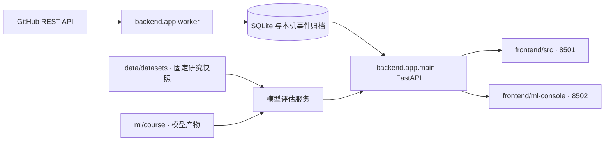

# 项目结构与模块边界

RepoVantage 按运行职责拆分为后端、普通用户前端、机器学习观测台、固定研究资产和模型生命周期资料。两套前端共享后端 API，但独立构建与运行。

## 运行结构



8501 提供普通用户工作台和 FastAPI；8502 是独立的机器学习观测前端，通过本机代理访问模型评估接口。Worker 负责 GitHub 采集和后台任务，数据库迁移由 Alembic 管理。

## 根目录

```text
.
├── backend/                  # FastAPI、业务服务、GitHub 接入、Worker
├── frontend/                 # Vue 普通用户前端与独立 ML 控制台
├── migrations/               # Alembic 数据库迁移
├── data/datasets/            # 经审查、随仓库发布的固定样本快照
├── ml/course/                # 课程研究模型、特征与评估产物
├── ml-production/            # 模型注册、准入证据与运行配置
├── scripts/                  # 仓库级 Python 命令与数据/模型工作流
├── tests/                    # 后端测试、契约测试与 fixtures
├── docs/                     # 架构、开发指南和指标约定
├── reports/                  # 研究结果、数据清单与历史归档
├── pyproject.toml            # Python 包与工具配置
├── uv.lock                   # 锁定的 Python 依赖
└── README.md                 # 项目入口、快速启动与能力概览
```

## 目录职责

| 目录 | 放置内容 | 边界约定 |
| --- | --- | --- |
| `backend/app/api/` | HTTP 路由、请求校验、浏览器 API | 适配 HTTP；业务流程交由 `services/`。 |
| `backend/app/services/` | 仓库、分析、数据集和模型评估用例 | 组合领域逻辑；不在路由里实现采集或评分算法。 |
| `backend/app/analytics/` | 指标、特征和图表序列计算 | 保持计算可复用，不依赖 Vue 组件。 |
| `backend/app/integrations/` | GitHub REST API 客户端 | 外部 API 访问集中在集成层。 |
| `backend/app/persistence/` | SQLAlchemy 数据库连接和实体 | Schema 变更通过根目录 `migrations/` 管理。 |
| `backend/app/pipeline/`、`worker/` | 事件清洗、归档回放、后台任务执行 | 长任务由 Worker 执行，HTTP 请求只负责提交和查询。 |
| `frontend/src/` | 8501 普通用户页面 | 只通过后端 API 获取业务数据。 |
| `frontend/ml-console/` | 8502 模型评估与运行观测界面 | 独立构建，通过后端 API 读取评估数据；不直接加载数据库。 |
| `data/datasets/` | 固定研究样本和历史事件包 | 仅纳入经过审核、可追溯版本化的数据包。 |
| `data/` 根目录运行文件 | SQLite、动态采集归档、本机状态 | 默认由 `.gitignore` 排除，不随代码提交。 |
| `ml/course/` | 离线研究特征、模型产物、固定评估结果 | 说明研究实验；不代表生产模型准入。 |
| `ml-production/` | 模型注册、外部验证、准入与调度材料 | 与课程研究产物分开维护，记录模型生命周期状态。 |
| `scripts/` | 仓库根目录执行的维护、数据和研究命令 | 已发布的 `python -m scripts.<命令>` 路径视为 CLI 接口；调整时同步更新调用方和文档。 |
| `tests/` | `backend/` 行为、API 契约、测试数据 | fixtures 与被测模块分开放置，避免混入运行数据目录。 |
| `docs/` | 架构、安装运维和指标口径 | 面向使用与维护者的约定文档；临时设计稿和本地资料包不纳入发布。 |
| `reports/` | 数据资产、模型实验和历史验收材料 | 研究结论与实现文档分开，历史材料显式标注归档状态。 |

## 依赖与数据约定

1. Web 前端不连接 SQLite，也不持有 GitHub Token 或 `INTERNAL_API_KEY`；外部凭据只由后端进程读取。
2. Git 管理代码、迁移、锁文件、明确选定的固定研究数据和评估产物；运行数据库与动态缓存留在本机。
3. `data/datasets/` 是可追溯研究快照；`data/app.db`、`data/collected/`、`.env` 是运行状态，二者不能混为一个“数据目录”。
4. `ml/course/` 与 `ml-production/` 表达不同生命周期：离线课程评估不会自动成为生产准入。
5. 根目录 `README.md` 是唯一项目首页；启动、后端、结构和模型研究说明分别放在对应文档位置。

## 常用入口

- 完整启动：`uv run --locked --all-extras python -m scripts.start`
- 单独启动机器学习观测台：`uv run --locked --all-extras python -m scripts.start_ml_console`
- 后端环境、配置与 API：[后端运维指南](../guides/backend-operations.md)
- 样本范围与数据边界：[数据资产清单](../../reports/数据资产清单.md)
- 课程模型实验：[150/150 留仓评估记录](../../reports/course-150-150/p2-training-and-evaluation.md)
