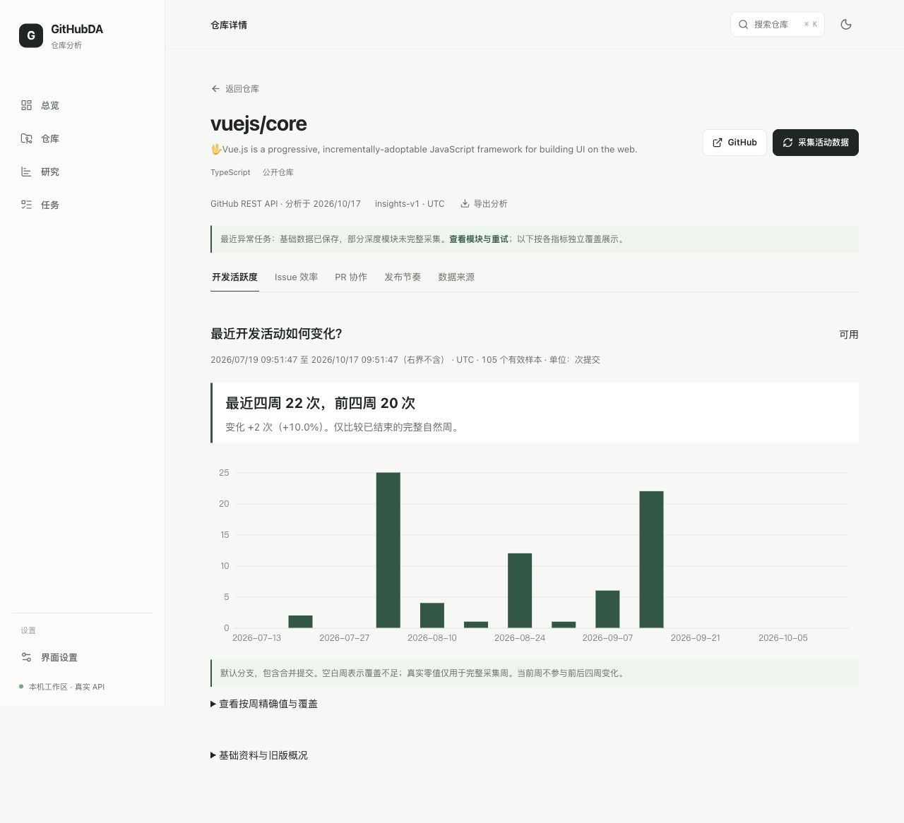
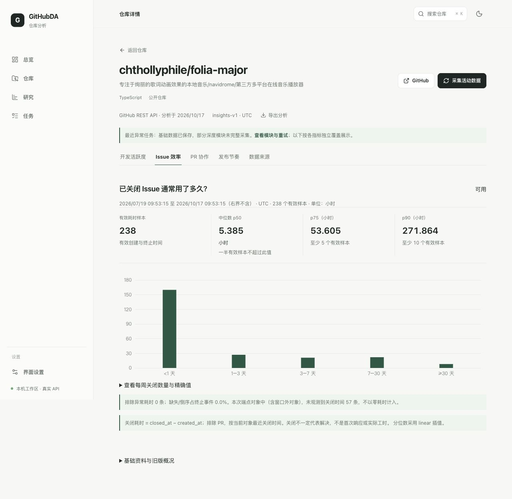
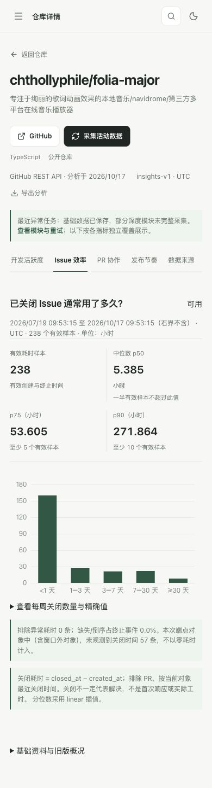
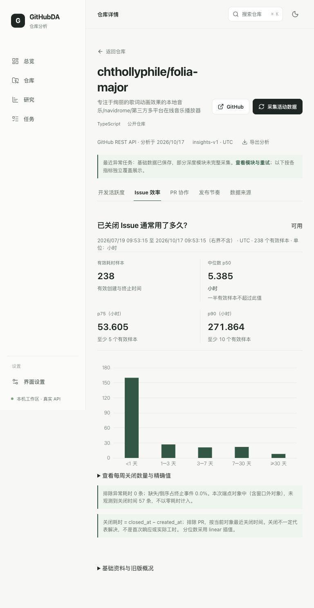
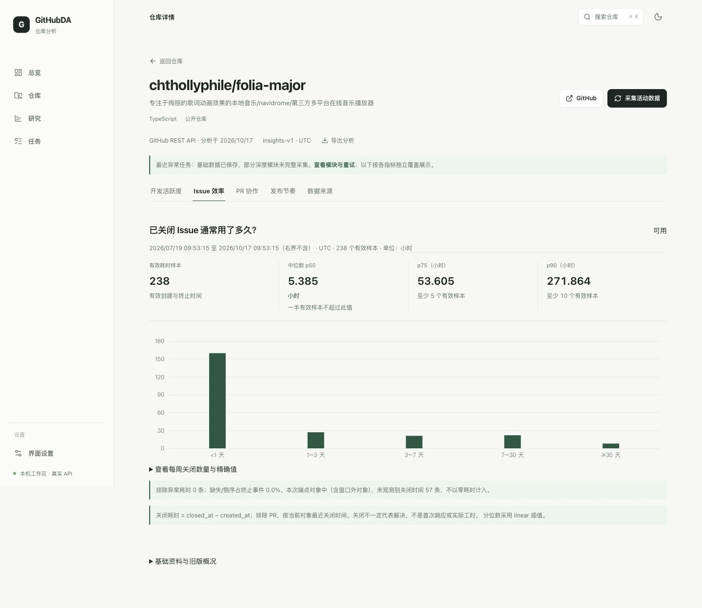
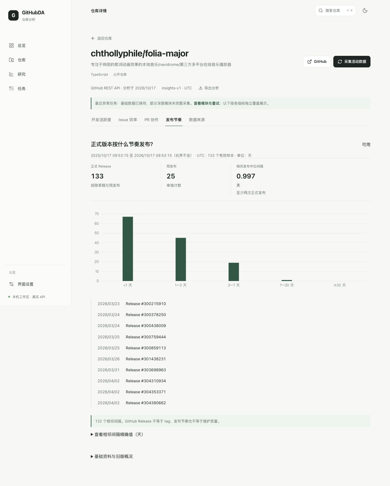
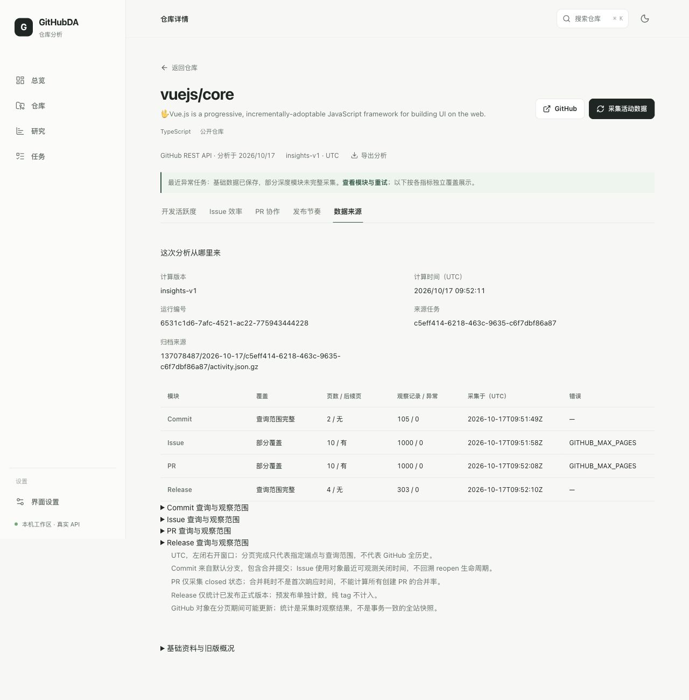
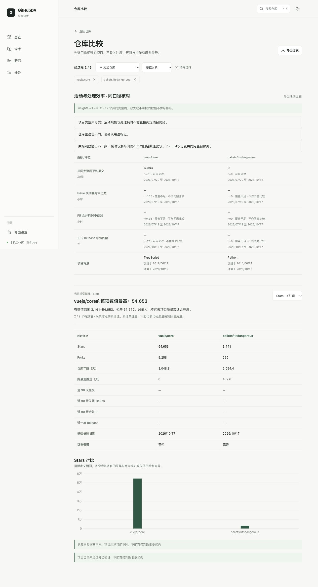
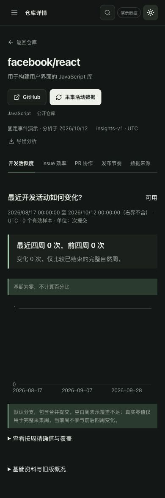

# 数据挖掘与可视化改造交付记录

日期：2026-10-17。基准：cff079afe87b0ea9015f5f0a7ebf746d1d4b78c8。工作分支：codex/insights-v1。开始时工作区仅有未跟踪 .DS_Store，保留。本轮代码已保存，未提交或推送。

## 完成的纵向功能

1. **事件采集到存储**：现有 GitHubClient 的分页与限流沿用；Worker 附带查询范围、观察范围、页数、has_next、错误及采集时点，规范化 Commit/Issue/PR/Release，按外部 ID 幂等 upsert。
2. **版本化分析**：insights-v1 不可变运行，记录窗口、来源任务、归档、样本与独立质量；相同输入指纹复用，新版本新建。分桶保存在 result_json，采用手册允许的小规模方案。
3. **P0 统计**：UTC 周一 Commit 分桶、八个已结束自然周的前后四周比较；Issue 关闭与 PR 合并耗时、有效样本、分位门槛、异常剔除与直方分布、每周吞吐。缺失不作零，partial 不生成完整趋势。
4. **API / Vue**：新增 insights、series、quality、CSV；详情五个视图，基础背景折叠。旧 analysis/series/比较/导出继续工作。真实请求失败不会回退演示。
5. **P1 已实现部分**：正式 Release 时间轴、间隔分布与中位数；比较使用共同完整周，耗时/发布窗口不同则不输出可比值；研究成员活动指标、语言分组、分布和受条件约束的相关。
6. **任务细节**：保留列表概要合同，展开时查询原有任务详情，显示模块页数、观察条数和错误；阶段进度不是覆盖率。
7. **安全回放**：本地命令默认只预览，--apply 才落库；路径、gzip大小、展开大小、JSON/版本/窗口/外部ID/时间受检查。不在打开页面时解压归档。

## 迁移与数据保护

- SQLite 一致备份：`data/backups/insights-v1-before.db`（仅本机，不入版本库）。升级前数量见 [migration-baseline.json](migration-baseline.json)：仓库2、快照7、任务7、旧分析11、数据集3、成员2。
- 在副本演练 upgrade → downgrade 0002 → upgrade，并核对全部上述历史数量；正式数据库只向前升级0003，新增事件与运行两表，未删除旧数据。
- 增加全新数据库升级测试，处理原0001通过当前metadata建表的兼容问题；旧库与新库两条路径均通过。
- 本轮新增一个公开仓库 itsdangerous 及4个采集任务（基础1、深度3）；研究成员和冻结规则未调整。

## 真实公开仓库验收

由 Codex 内置浏览器发起采集。原始归档、任务、运行、完整模块范围、独立复算样本见 [real-verification.json](real-verification.json)。不能把以下模块范围等同于GitHub全历史。

| 仓库 / ID | 实际结果 | 请求 / 耗时 | 局限 |
|---|---|---|---|
| pallets/itsdangerous / 1945034 | 12个完整周的Commit为真实0；耗时无样本 | 深度8次 / 10.02秒 | 无Issue/PR耗时样本，不画假分布 |
| vuejs/core / 137078487 | 有效Commit105；最近4周22、前4周20，+10%；正式Release21 | 27次 / 24.80秒 | Issue和PR达到页数上限，显示partial；不作总体分布 |
| chthollyphile/folia-major / 1105953775 | Issue n=238，p50=5.384722小时；PR n=153，p50=0.27小时；正式Release133 | 22次 / 20.04秒 | Commit观察1000条但分页未完，不画绝对趋势 |

- 独立读取原始分页、按ID去重、日期筛窗：两种耗时的n与中位数逐项匹配；所有ready周桶均与原始提交日期计数匹配。复算不是重用页面文案。
- 实际CSV导出53行，验证Issue/PR中位数、版本、单位、窗口和任务列：[真实导出](evidence/real-insights.csv)。
- 对itsdangerous执行真实本地 `--apply` 回放，复用run `4b996a32-7343-4d0f-9cbb-2fb20134258d`，未产生重复事件/运行。
- 性能日志见 [performance.json](performance.json)：本轮无实际限流/超时，SQLite约1.77MB。未测隔离进程峰值内存，也未执行长期并发压力基准。

## 测试与浏览器证据

- 基线：后端55项、旧版前端15项通过；最终：`.venv/bin/pytest tests/backend -q` **67项通过**；旧版前端在删除前23项通过且构建通过（历史记录）。当前 Vue 前端构建使用 `npm --prefix frontend run build`。
- 新测试覆盖：周界与右开窗口、SHA/PR去重、59/30差值、零基期、六周拒算、部分模块独立、耗时异常/分位门槛、正式/草稿/预发布、Worker真实事件管线、事件校验异常使任务标partial且保留ready模块、安全回放和复用、版本共存、API/导出、比较窗口、研究隔离、缺失与请求失败保留旧图。
- 内置浏览器12条显式断言通过：[iab-e2e.json](evidence/iab-e2e.json)，涵盖固定事件、耗时、键盘切换、partial独立、未采集、小样本、限流、过期、零和深色。另完成真实输入→基础→深度→自动更新→API/图表/原始复核流程。
- 五个视图 × 390/768/1280/1440：document.scrollWidth均不大于viewport；表格/标签局部滚动。几何记录见 [responsive.json](evidence/responsive.json)，隐藏折叠区内图表宽0属预期。
- 正式CLI Playwright套件新增3条、更新与新UI不符的旧断言，`test:e2e -- --list` 识别10条；**未启动独立Chromium执行CLI套件**，浏览器运行验证通过Codex内置浏览器完成，遵守用户仅允许操控内置浏览器的范围。不把列出测试当成运行通过。
- Node experimental localStorage、Starlette TestClient及Alembic配置弃用提示为非阻塞警告。期间回归发现任务列表合同差异、Mock服务漏方法类型、全新迁移重复建表，均已修复后重新运行通过。

## API与运行

一键启动仍为 `uv run --locked --all-extras python -m scripts.start`，地址127.0.0.1:8501。新增API详见 [README_backend](../../README_backend.md)、[OpenAPI快照](openapi-insights.json)；同源会话、CSRF和内部Key隔离继续生效，新增测试确认503不回退Mock、前端不发内部Key。

模块拆分保持现有结构：`pipeline/event_normalizer.py` 与 `archive_replay.py`，`analytics/insights.py`，`services/insights.py` 与 `insight_comparison.py`，新增schemas/router。没有引入前端依赖、LLM评分、预测、全站爬取或恢复旧框架。

## 尚未完成 / 已知限制

- **P1**：贡献者趋势和创建PR cohort的30天转化率未实现；当前采集无法支持完整身份或cohort分母。未实现在线recompute POST，已提供本地安全回放CLI（手册允许首轮暂缓）。
- 比较中的耗时采用严格相同窗口条件，单独采集的仓库通常不同秒；当前会阻止这些值直接比较。后续可增加统一窗口的事件重算，不能把当前缺失标记当成已有能力。
- 研究集当前真实成员0、未冻结；真实非空研究图表未验收。API测试验证了成员隔离/有效指标，新UI如实空态，未为了图表给研究集造样本。
- 旧归档缺查询合同则保守partial；不把回放旧数据宣称为新完整采集。PR现有closed端点、Issue对象级reopen语义、Commit默认分支和分页上限均保留限制说明。
- CLI E2E运行、断网代理的浏览器级注入、隔离峰值内存与长期压力测试尚未完成。限流/错误使用确定性测试与演示场景验证，本轮真实请求未触发限流。
- **P2**均未实施。没有宣称完成手册所有可选项或完整性能/可用性审计。

## 截图

