# 降低上手难度与分析表达改造计划

日期：2026-10-17。范围：现有 Vue 前端；保持四项主导航、视觉体系、字体和现有 API 路径；比较响应补充向后兼容的来源字段。

## 目标与判断

让第一次使用的人知道输入什么、会得到什么、下一步做什么；让分析阅读者能分清事实、解释和局限。专业性来自指标口径、有效样本、数据时间与可复核比较，不来自虚构评分或装饰图表。

## 当前流程审查

本轮在 Codex 内置浏览器捕获。操作链：总览 → 已保存仓库详情 → 比较 → 研究。

1. 总览：入口可用，但例子不可填入；基础和活动采集的区别未说明；没有面向问题的下一步。键盘入口已有名称，但帮助文字偏小。
   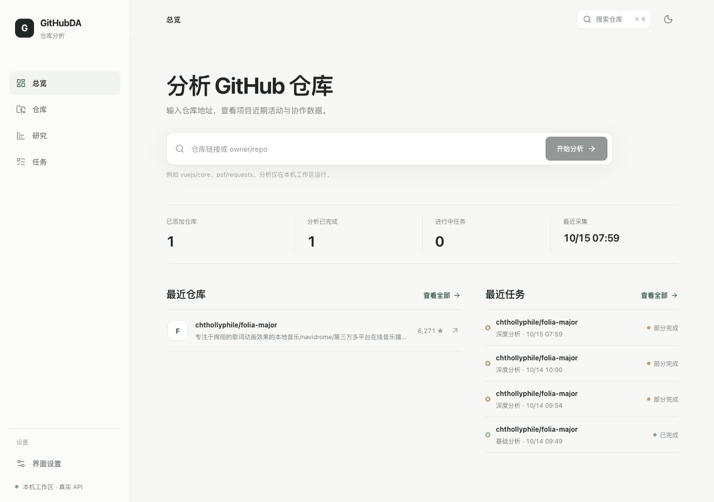
2. 详情：数值可读，但缺少解释；代码固定请求 basic，不能读取已有 deep 结果。总状态“部分完成”与基础结果“完整覆盖”并列，容易误解为矛盾。标签语义也需补齐。
   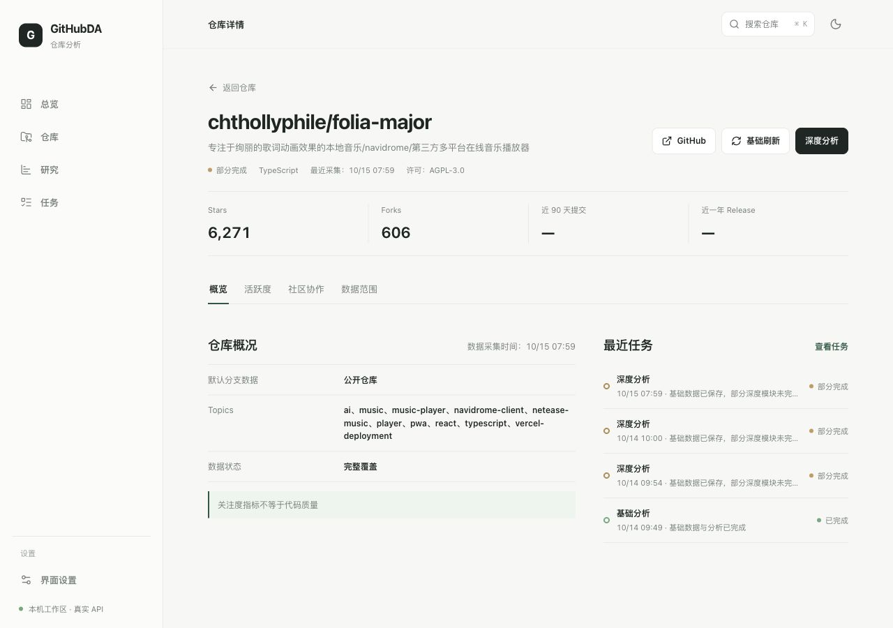
3. 比较：能选仓库，但空状态未解释应选什么；结果只并列数值，缺少差异摘要；相同指标定义并不代表相同采集时点。
   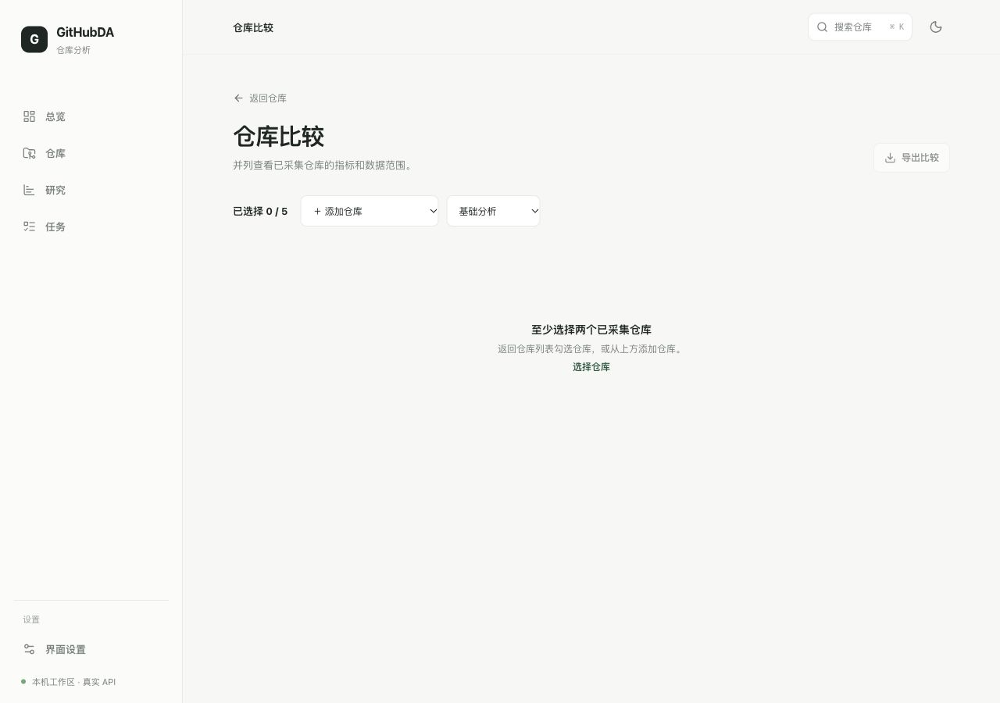
4. 研究：真实研究集为空，空状态没有后续路径；有效样本为零时数据质量视图也被隐藏。统计文案仍出现“演示样本”，真实来源不清楚。
   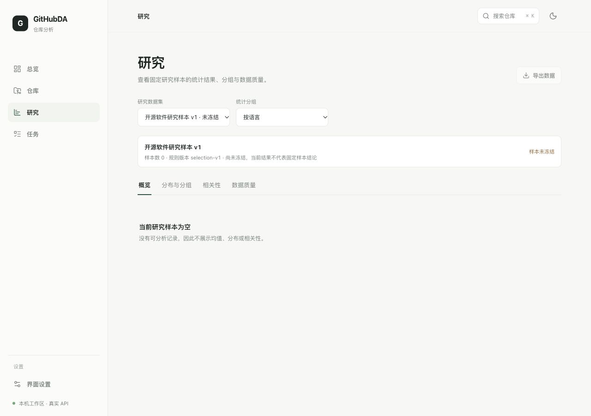

以上为截图、实际页面与代码共同确认的问题。截图不构成完整无障碍合规证明；本轮检查键盘、名称、重排与语义，不宣称 WCAG 全面通过。

## 实施顺序与验收

### 1. 首次使用与任务入口

- 可点选的仓库示例只填入输入框；用户提交后才创建分析。
- 说明基础概况与活动采集的产出；给出输入、阅读、比较的三步路径。
- 用具体问题引导到已有仓库、比较和研究；修正仓库页页眉标题。
- 验收：不用读开发文档即可找到首个输入、理解分析范围、进入已有结果。

### 2. 单仓库结果阅读

- 同时读取已存在的 basic/deep 结果，默认展示已有的活动结果，允许切换结果范围。
- 所选范围的状态、采集日期、指标和局限保持一致；不拿基础结果冒充深度结果。
- 用确定性规则生成事实摘要，区分 null、0、部分覆盖；给出指标含义和下一步。
- 活跃任务期间刷新结果；加载失败有明确重试，防止路由切换后旧请求覆盖新仓库。
- 验收：零值可读、缺失不等于零、部分覆盖明确、已有深度指标可见。

### 3. 比较与研究

- 比较显示有效值数、最大最小差异与范围限制，不生成质量排名。
- 研究显示样本内的中位数、分组与 Spearman 解释；统一中文名称与 p 值格式。
- 空样本提供准备步骤，数据质量仍可读；固定样本与全站推断的边界清楚。
- 验收：少于两个仓库不调用比较；不足样本不计算假统计；缺失值不进入差异计算。

### 4. 验证与交付

- 纯计算单元测试保护 null/0、分母为零、同值、负向关联等实际规则。
- Vue 类型检查、生产构建、已有前端测试。
- 内置浏览器实际操作示例、范围切换、标签、比较、研究空态、亮/暗主题、窄屏与桌面。
- 保存改造后截图和检查记录。真实库目前只有一个仓库、研究集为空；复杂比较/研究分支用隔离演示数据验证并明确标识，不改写真实库。

## 验证记录

已实施。没有新增前端依赖或数据库迁移。真实应用仍运行在 127.0.0.1:8501；验证用演示端口 5174 已停止，临时标签已关闭。

### 四步完成情况

| 步骤 | 改造结果 | 实际验证与边界 |
|---|---|---|
| 1. 总览与开始使用 | 示例填入、三步说明、问题入口、已有结果捷径；明确首次采集范围 | 内置浏览器点击示例只填入地址，未提交真实任务；桌面与窄屏通过 |
| 2. 单仓库阅读 | 基础/活动范围独立读取；来源日期、覆盖、事实解读、指标口径；有活动任务时自动更新 | 真实已有结果显示 225 个关闭 Issues、144 个合并 PR、157 个 Release；提交数缺失仍为“—”。切回 basic 后活动值不混入；ArrowRight / End 键切换通过 |
| 3. 多仓库比较 | 精确值、有效值数、最大最小差异、年龄/推送背景、基础日期和活动窗口；补全纵轴标签 | 真实库只有一个仓库，空状态通过；隔离演示比较 48,600 与 240,000，相差 191,400。基础提交为空时不绘制图表，切换活动结果后显示 188 与 92 |
| 4. 研究阅读 | 术语渐进说明、均值/中位数/标准差/n、分组与 Spearman 解释；空样本准备路径；质量页独立可读 | 真实空研究集显示 0/0 与准备步骤。非空演示 n=23，语言分组 9+6+5+3=23；ρ=0.86、p=0.010，明确只描述当前样本 |

### 代码与接口说明

- `OverviewPage.vue`、`RepositoryDetailPage.vue`、`ComparePage.vue`、`ResearchPage.vue`：沿用既有页面与路由，调整阅读顺序与操作路径。
- `lib/analysis.ts`：以确定性规则解释事实，保留 null/0、部分覆盖、同值和不足样本的区别；不判断代码质量或生成综合分数。
- `services/domain.ts` / `http.ts`：保留所选分析范围的采集时点和窗口。
- 比较 API 在每个仓库行新增 `source.profile_collected_at`、`analysis_collected_at`、`analysis_depth`、`window_start`、`window_end`。仅增加字段，旧字段与 CSV 契约保留；缺少 deep 时的 basic 回退明确标识。
- `TrendChart.vue`：纵轴使用中文紧凑单位、网格包含标签；统计表保留精确值，避免大数取整掩盖比较差异。
- `mock.ts`：演示模式区分基础与活动结果；修正语言分组总数与有效样本数不一致的问题。
- 比较切换范围时清除上一次结果，加载期间不把旧范围数值显示在新范围标题下；异步请求通过版本号避免旧响应覆盖新选择。

### 检查结果

- `npm run build`：通过，包含 `vue-tsc --noEmit`。
- `npm test`：5 个文件、15 项测试通过。覆盖零与缺失、部分覆盖、同值比较、零基准增长、负向/未定义相关、基础/活动分离和范围切换期间不显示旧比较。
- `.venv/bin/pytest -p no:cacheprovider tests/backend/test_comparison_export.py tests/backend/test_api_contract.py -q`：17 项通过，包括快照日期与活动结果日期不同、缺少深度结果回退的来源契约。
- 内置浏览器真实页面：首页、已有仓库详情、范围切换、键盘标签、指标口径、研究空态与质量页。
- 隔离演示页面：多仓库基本/活动比较、无值图表状态、研究分组/相关/质量、首次添加 → 排队 → 自动显示基础结果；活动范围仍显示未采集。测试数据恢复初始值。
- 390 像素：真实首页、详情、研究、比较空态均 `documentElement.scrollWidth = 390`；演示比较表容器 354、内部宽 376，研究表内部宽 605，滚动局限于表格。1280 像素桌面布局通过。
- 亮色、深色、窄屏截图已检查；最终真实应用和演示应用控制台均未捕获 error/warn。
- `git diff --check`：通过。依赖与源码扫描未发现 Streamlit / Plotly 运行引用。
- 非阻塞检查提示：Node 报告实验性 localStorage 警告，后端报告 Starlette TestClient 弃用警告；测试均通过。

### 本轮未验证与已知数据限制

- 没有新建真实 GitHub 采集任务。自动完成流程与非空多仓库/研究交互使用明确标识的隔离演示数据验证，不作为新的真实采集或研究证据。
- 真实研究集仍为空、未冻结，已有仓库只有一个实际观测日期；页面据此展示空态，不绘制趋势或假统计。
- 未进行用户可用性访谈、长期任务压力测试或完整 WCAG 审核。截图与布局尺寸检查不等于这些验证。
- 一次浏览器自动化读取遇到两个 `status` 元素，改用最新 DOM 核对恢复结果；属于定位器歧义，未发现对应应用故障。

## 改造后截图

总览：
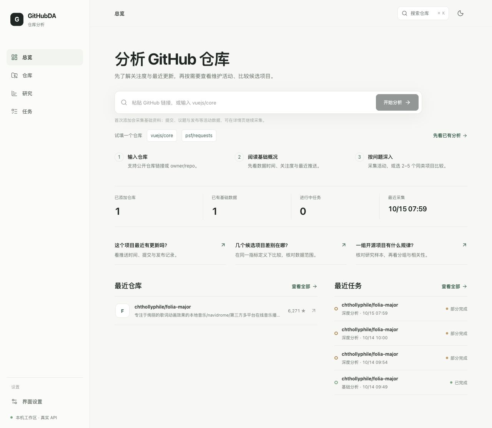

真实仓库解读：
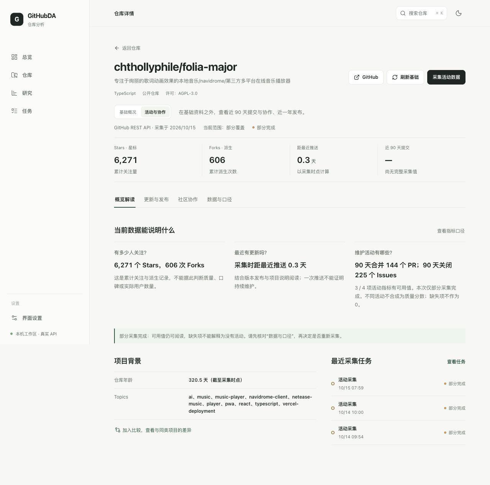

比较（明确标识的演示数据）：
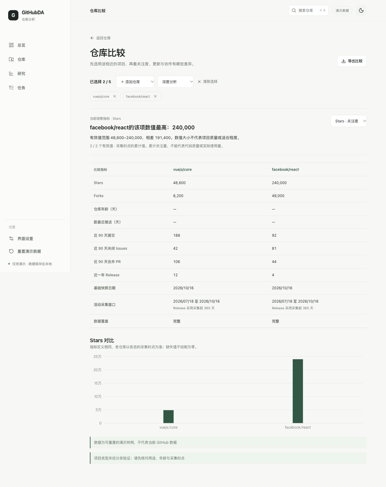

真实研究空态：
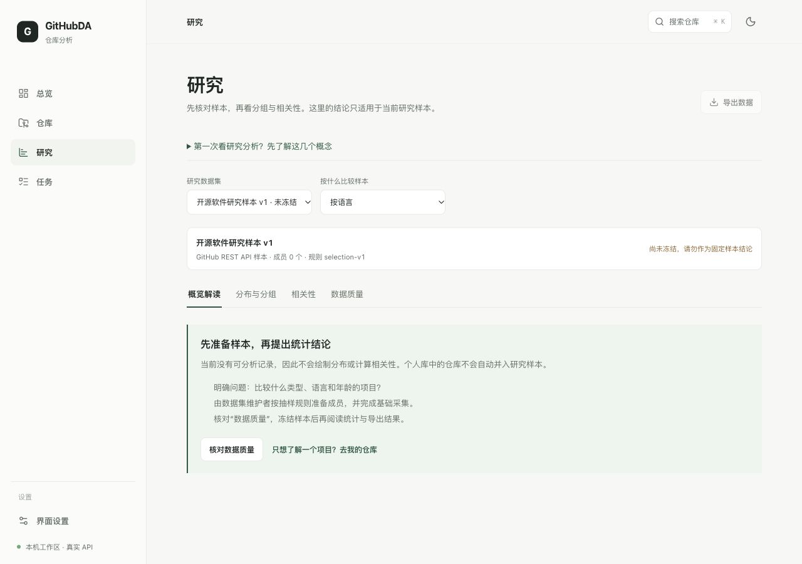

非空研究（演示数据）：
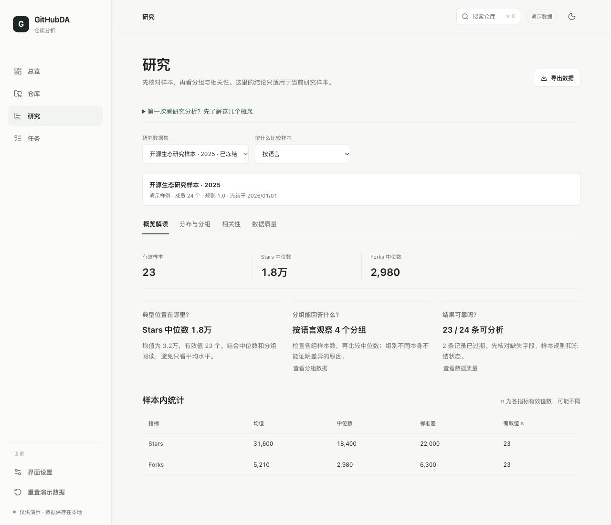
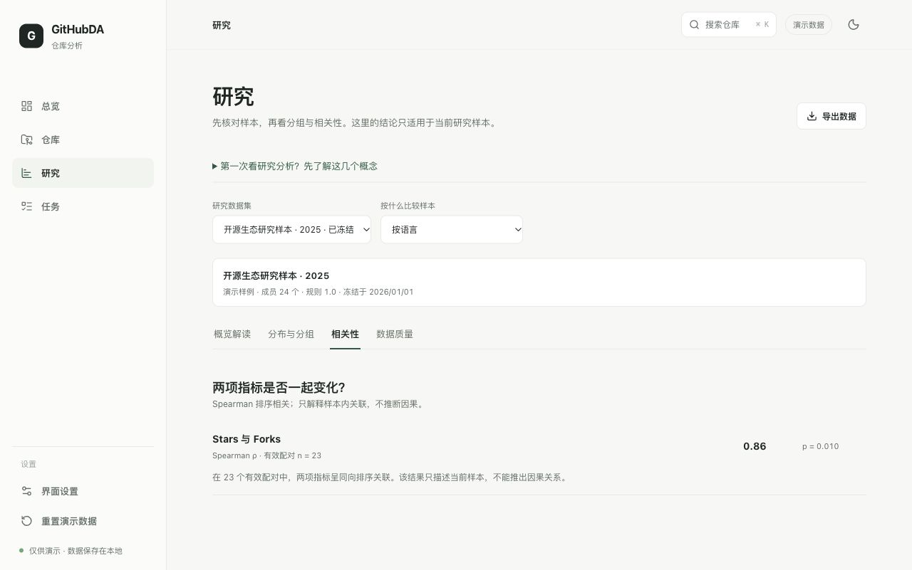

窄屏与深色：
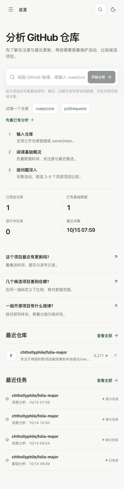
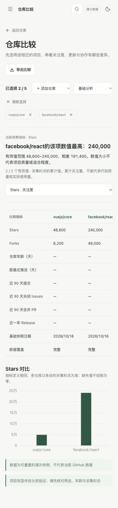
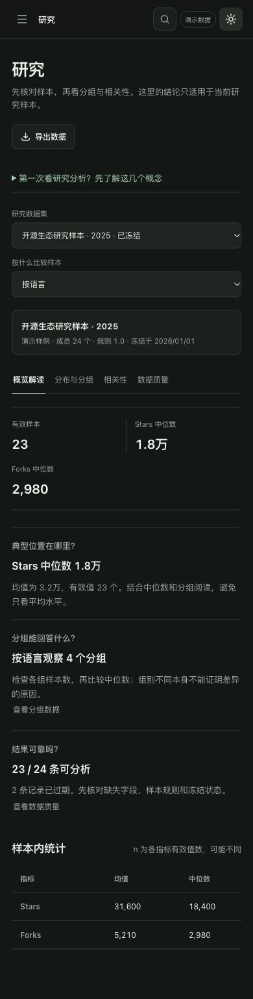

