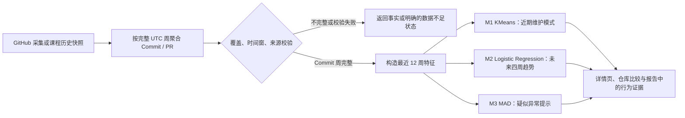

# RepoVantage 机器学习模型说明

- **整理日期：** 2026-11-14
- **核对范围：** 当前工作区源码、课程版模型产物、模型评估记录与 `ml-production` 注册表
- **说明目的：** 解释系统中哪些模型会进入分析流程、模型如何工作、能说明什么，以及不能据此得出什么结论。

## 1. 先看结论

当前代码中，仓库详情与比较分析使用的课程版路径接入了两个机器学习模型：

1. **M1 近期维护模式聚类**：`StandardScaler + KMeans(K=3)`，把最近 12 个完整 UTC 周的 Commit 活动归纳为三种行为模式。
2. **M2 未来四周活动趋势分类**：带类别平衡权重的多分类 Logistic Regression，输出“上升、基本稳定、下降”之一。

此外，**M3 活动异常提示使用 MAD 稳健统计规则，不是机器学习模型**。Isolation Forest 做过离线研究，但没有接入当前异常提示。

要特别区分课程版模型与 `ml-production` 下的生产候选：课程版 M1/M2 已接入课程演示和历史样本分析流程，但不宣称生产级或外部泛化验证。另一个 52 周的 `ML-03 v5` 候选仍是 `research_only`，没有获准生产加载。

## 2. 分析流程与数据边界



课程版模型读取最近 **12 个完整 UTC 周**。界面允许额外采集至 24 周时，额外周用于背景事实；M1/M2 仍按最近 12 周建模。M1、M2 的输入特征基于 Commit 周计数；PR 周计数作为独立事实证据展示，不作为这两个模型的当前输入。

后端先检查连续周边界、Commit 覆盖、来源归档与哈希。缺失或未覆盖的周不会补成 0。Commit 数据不完整时，M1/M2/M3 不会把局部观察当作完整历史进行推理。M2 另有低活动范围门槛：最近四周 Commit 少于 3 次，或最近 12 周活跃周少于 3 周时，不给出趋势预测。

主要实现位置：

- 特征与数据校验：[`backend/app/analytics/course_ml_features.py`](../../backend/app/analytics/course_ml_features.py)
- 课程版推理：[`backend/app/services/course_ml.py`](../../backend/app/services/course_ml.py)
- 采集结果、完整性检查与分析汇总：[`backend/app/services/maintenance.py`](../../backend/app/services/maintenance.py)
- 仓库分析接口：`POST /api/v1/repositories/{id}/maintenance-collection`、`GET /api/v1/repositories/{id}/evaluation`

模型文件是受控 JSON 数值产物。后端按模型中的缩放参数、聚类中心或线性系数直接完成推理，不需要在线调用 sklearn，也不会在每次用户请求时重新训练模型。

## 3. M1：近期维护模式聚类

### 3.1 任务

M1 是无监督聚类：没有人工提供的“好项目/差项目”标签。模型根据近期 Commit 活动的形状，把行为相近的仓库放入同一簇，再依据训练簇的统计画像显示便于理解的名称。

当前运行版本：`ml03-12w-150train-v1`，特征版本：`course-maintenance-12w-v1`。虽然产物文件名含 `ml03`，产品任务名是 **M1 maintenance pattern**；它不是下文 52 周生产研究目录中的 `ML-03 v5`。

### 3.2 输入特征

每个仓库使用最近 12 周 Commit 周计数生成 5 项特征：

| 特征 | 含义 |
|---|---|
| `commit_active_fraction` | 12 周中至少有一次 Commit 的周占比 |
| `commit_log_cv` | `log1p(每周 Commit)` 序列的波动程度 |
| `commit_longest_zero_fraction` | 最长连续无 Commit 周数占 12 周的比例 |
| `commit_recent_change_log1p` | 最近 4 周与此前 8 周平均 Commit 的对数变化 |
| `commit_top2_share` | Commit 最集中的两周占 12 周总 Commit 的比例 |

这些特征分别描述活动持续性、波动性、近期变化和活动是否集中在少数周；不包含代码内容、Issue 内容或项目质量标签。

### 3.3 算法和推理

训练时先用 `StandardScaler` 将不同量纲的特征缩放，再用 `KMeans` 拟合训练仓库。当前选用 **K=3**。推理时对新仓库计算同一组特征和缩放值，再分配给距离最近的聚类中心。训练产物保存均值、缩放尺度、聚类中心及各簇画像。

当前三个显示名称是：

- **集中活动型**：Commit 相对集中在少数周，活跃周比例较低。
- **低活动型**：近期 Commit 很少或没有。
- **持续活动型**：较多周有 Commit，活动在时间上相对持续。

名称只是对近期特征的描述。比如“低活动型”不能单独证明仓库已停止维护；活动也可能发生在未观察到的分支、PR、Issue 或其他渠道。

### 3.4 训练评估

v4.4 课程实验将既有 300 个仓库按固定仓库名单分为 150 个训练仓库与 150 个留出测试仓库。训练集上 K=3 的轮廓系数为 0.4885，测试集为 **0.5231**；只按 Commit 规模分组的测试基线为 0.2523。十个随机种子之间的平均 ARI 为 1.0，表示这次训练切分下聚类对种子较稳定。

轮廓系数衡量簇内相似和簇间分离程度，不能解读为“52.3% 准确率”。这 300 个仓库此前已用于课程研究，所以本轮属于固定留仓的历史回测，不是全新采集的外部验证。

## 4. M2：未来四周活动趋势分类

### 4.1 任务和标签

M2 是有监督的三分类模型。对一个历史观察点，模型读取此前 12 周特征，预测其后 4 周 Commit 活动属于：

- **上升**：未来 4 周总 Commit 比此前 4 周增加至少 `max(3, 此前 4 周总量 × 25%)`。
- **下降**：未来 4 周总 Commit 比此前 4 周减少至少同一阈值。
- **基本稳定**：变化幅度未达到阈值。

绝对阈值至少为 3 次 Commit，目的是避免把极稀疏活动中的 `0 → 1` 当成有意义的增长。

### 4.2 输入与算法

输入包括 5 项 Commit 特征：最近 4 周平均活动、此前 8 周平均活动、12 周活跃周占比、对数活动波动和近期相对变化。训练时比较了多数类基线、近期趋势基线、Logistic Regression 和 HistGradientBoosting；当前运行版本选用：

- `StandardScaler`
- `LogisticRegression(C=0.1, class_weight="balanced")`

`class_weight="balanced"` 用于缓和不同趋势类别样本量不均衡。运行时对标准化特征计算各类别线性分数，选择得分最高的类别。界面只显示类别，不显示未经校准的概率，也不估算精确 Commit 数量。

当前运行版本：`ml01-trend-12w-150train-v1`。`ml01` 是模型产物的内部版本命名；页面任务名称是 **M2 activity trend**。

### 4.3 留出测试结果

固定留出测试中，候选模型 Macro-F1 为 **0.5409**、Balanced Accuracy 为 **0.5791**；近期趋势基线分别为 0.4396 和 0.4425，多数类基线分别为 0.2222 和 0.3333。

测试集混淆矩阵如下，行是真实类别、列是模型预测类别：

| 真实类别 | 预测下降 | 预测基本稳定 | 预测上升 | 样本数 |
|---|---:|---:|---:|---:|
| 下降 | 19 | 0 | 7 | 26 |
| 基本稳定 | 11 | 51 | 13 | 75 |
| 上升 | 14 | 19 | 16 | 49 |

“上升”类 Recall 为 **0.3265**，也就是留出测试中的上升样本约三分之一被识别为上升。整体指标好于本轮基线，但不能因此认为每种项目、活动规模或未来时期都可靠。测试数据来自既有课程数据；历史窗口有重叠，不能视为独立的新仓库前瞻验证。

### 4.4 作用边界

M2 可作为观察活动趋势的补充线索，帮助用户尽早关注可能的活动变化。它不能替代项目路线图、Issue/PR 处理情况或人工判断。低活动、短历史或数据覆盖不足时，系统不预测；模型文件不可用时，系统最多显示历史变化基线，并明确说明那不是未来预测。

## 5. M3：近期活动异常提示（统计规则）

M3 不是训练得到的异常分类模型。它将最近完整周 Commit 数与此前 11 个完整周比较：先对计数做 `log1p` 变换，以历史中位数作中心，以 `1.4826 × MAD` 作稳健尺度，并将尺度下限设为 0.25：

```text
robust_z = (log1p(当前周 Commit) - 历史中位数) / max(1.4826 × MAD, 0.25)
```

当 `|robust_z| >= 3` 时，输出“疑似增加”或“疑似减少”，并提供对应周、活动量和偏离值供人工核查。它只说明本周相对近期历史较突出，不说明异常原因，不等价于仓库衰退、维护失败或项目放弃。

研究中曾训练 `IsolationForest`（200 棵树）与此规则做对照，但没有真实人工标签，现有触发量和重合率不能当作准确率。因此 Isolation Forest 没有进入产品的 M3 推理路径。

## 6. 独立生产化研究模型：52 周 ML-03 v5

`ml-production` 中另有一个面向长期时间形态的研究候选，和课程版 12 周 M1 聚类是不同模型：

- **目标**：根据 Commit 与新建 PR 在 52 周内的时间分布，研究仓库活动形态差异；不预测未来、不推荐采用、不输出质量分。
- **算法**：`StandardScaler + KMeans(K=2)`，随机种子 `20261109`。
- **输入**：Commit 周事件份额与 PR 周事件份额的归一化 Shannon 熵。
- **范围**：52 个完整 UTC 周；训练时要求完整覆盖，且至少 20 次 Commit、10 个新建 PR。
- **当前状态**：注册表为 `research_only`，没有批准模型文件或审批记录。
- **未通过原因**：冻结的 75 个独立外部仓库中，30 个无法可靠归类，拒判率 40%，超过预设 35% 上限；真实双人复核和负责人批准也未完成。

因此，这个候选目前不能作为获批生产模型输出给用户。注册表及验收文件：[`ml-production/registry.json`](../../ml-production/registry.json)、[`ML-03 v5 模型卡`](../../ml-production/reports/ml03-v5-model-card.md)、[`独立外部验收`](../../ml-production/reports/external-validation-v5.md)。

## 7. 对产品的意义

目前模型的价值主要是把周级活动数据转换成更容易理解的行为摘要：

1. **降低阅读成本**：用户不必只靠查看 12 周曲线来概括 Commit 节奏。
2. **补充比较维度**：详情和仓库比较可以并列展示维护模式、趋势预测、覆盖范围与实际计数。
3. **提示关注方向**：趋势或异常提示可帮助用户决定是否进一步查看近期仓库事件。
4. **支持透明判断**：模型输出旁保留观察窗口、数据来源、覆盖状态和限制说明。

模型结果是证据，不是决策本身。仓库比较和选型报告中的排序仍使用显式规则与用户选择的事实指标；ML 结果不进入规则得分，也不表示采用成功率。

## 8. 当前限制与正确解释方式

- **不是代码质量模型**：输入集中在 Commit 周计数与其时间分布，不分析源代码语义。
- **不是全面的社区健康模型**：课程版 M1/M2 不使用 Issue 内容、PR 合并耗时、Release 或代码审查质量。
- **不是在线自学习**：模型以固定 JSON 产物推理；新数据不会自动触发重训练。
- **历史结果不等于未来保证**：课程训练和测试来自既有 300 仓库数据，不能代表新仓库或未来分布。
- **活动口径有限**：在线 Commit 按采集时可见的默认分支记录；不能还原所有历史分支当时的完整成员情况。
- **完整性优先**：观察不足、采集过期、分页不完整、来源哈希不匹配时，系统停用相应判断或回退到事实展示。
- **趋势类别不确定**：M2 当前上升类召回偏低，应结合原始周数据和项目事件查看。
- **异常需要核查**：M3 的“疑似”是稳健统计信号，不是已标注验证的异常分类结论。

## 9. 当前产物与实现索引

| 内容 | 路径 |
|---|---|
| M1 当前 JSON 推理产物 | [`ml/course/artifacts/ml03-maintenance-pattern-12w-150train-v1.json`](../../ml/course/artifacts/ml03-maintenance-pattern-12w-150train-v1.json) |
| M2 当前 JSON 推理产物 | [`ml/course/artifacts/ml01-activity-trend-12w-150train-v1.json`](../../ml/course/artifacts/ml01-activity-trend-12w-150train-v1.json) |
| M1/M2 当前推理入口 | [`backend/app/services/course_ml.py`](../../backend/app/services/course_ml.py) |
| 周特征、标签和 MAD 公式 | [`backend/app/analytics/course_ml_features.py`](../../backend/app/analytics/course_ml_features.py) |
| 150/150 训练与留出评估 | [`reports/course-150-150/p2-training-and-evaluation.md`](../course-150-150/p2-training-and-evaluation.md) |
| M1/M2 接入记录和数据门槛 | [`reports/course-150-150/p3-model-switch-and-compatibility.md`](../course-150-150/p3-model-switch-and-compatibility.md) |
| 52 周 ML-03 生产化状态 | [`ml-production/registry.json`](../../ml-production/registry.json) |

## 10. 一句话总结

RepoVantage 当前课程分析链路使用 **KMeans 描述近期维护模式**、**Logistic Regression 分类未来四周活动趋势**；异常提醒使用 **MAD 统计规则**。这些能力帮助组织和解释仓库活动证据，但不衡量项目质量或成功概率，也不替代用户决策。课程版模型已经接入代码路径，生产级 52 周 ML-03 研究候选仍未获批准。
